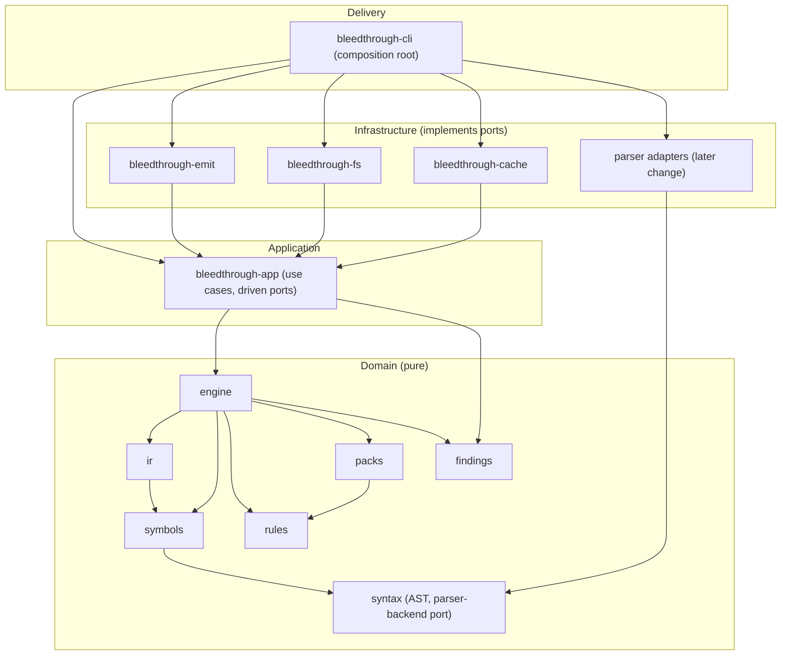

# Architecture

Bleedthrough follows Domain-Driven Design and SOLID. The Cargo dependency graph is the architecture:
`architecture.toml` declares it and `cargo xtask check-layering` enforces it.

## Layers

Edges omitted for readability are listed in `architecture.toml`. `syntax`, `rules` and `findings`
depend on no workspace crate. `xtask` is tooling: nothing depends on it and it depends on no product crate.
A language-server front-end is **reserved and not created**; like the CLI it would be a thin delivery crate.

- **Domain** is pure: no file system, network, process, environment or clock, and no format or async-runtime crates.
- **Application** holds the scan use cases and owns the ports for sources, caching, lock files and emitting reports.
- **Infrastructure** implements ports. Parser adapters are the only crates allowed to depend on a third-party PHP parser, at an exact version.
- **Delivery** chooses and wires concrete implementations. Nothing depends on it.

Ports are owned by the inner layer, so the dependency direction in Cargo is the direction of the abstraction.

## What is verified, and how

| Principle | Verification | Method |
| --- | --- | --- |
| Dependency rule / dependency inversion | CI | `cargo xtask check-layering` |
| Domain purity | CI (proxy, not proof) | per-crate `clippy.toml` `disallowed-*` plus manifest deny-list in `architecture.toml` |
| Encapsulation / stable surface | CI | `cargo xtask check-api` snapshots in `api/` |
| Open for extension (data types) | CI | `clippy::exhaustive_enums` / `exhaustive_structs` in domain and application crates |
| Size and complexity | CI | `clippy.toml` limits on cognitive complexity, function length, argument count |
| Ubiquitous language | CI (presence, not quality) | `cargo xtask check-glossary` against `docs/glossary.md` |
| Parser isolation and pinning | CI | `cargo xtask check-layering`, `cargo deny` bans |
| Licenses, advisories, sources | CI | `cargo deny check` |
| Single responsibility | Review | [architecture-review.md](architecture-review.md) |
| Interface segregation | Review | [architecture-review.md](architecture-review.md) |
| Liskov substitution | Review | [architecture-review.md](architecture-review.md) |
| Open/closed design quality | Review | [architecture-review.md](architecture-review.md) |
| DDD boundaries (naming, aggregates, ports) | Review | [architecture-review.md](architecture-review.md) |

**Green CI does not demonstrate the review-only principles.** Interface segregation is deliberately not
proxied by a trait-method-count limit, to avoid gaming a number.

## Known limits of the checks

- **Public API extractor** (`cargo xtask check-api`) works from source with `syn` on the pinned stable
  toolchain. Items generated by macros are not seen, glob re-exports are recorded as written and not
  expanded, and trait impls are recorded wherever they appear in a public module. `#[path]` modules are
  rejected. The review checklist covers these gaps.
- **Domain purity** via clippy can be bypassed through re-exports or other crates; the manifest deny-list and review back it up.
- **Glossary check** measures that a term is named, not that the name is good.
- **`unsafe`** is forbidden workspace-wide through inherited lints; a crate that needs it must stop inheriting lints, which the inheritance check flags and review must justify.
