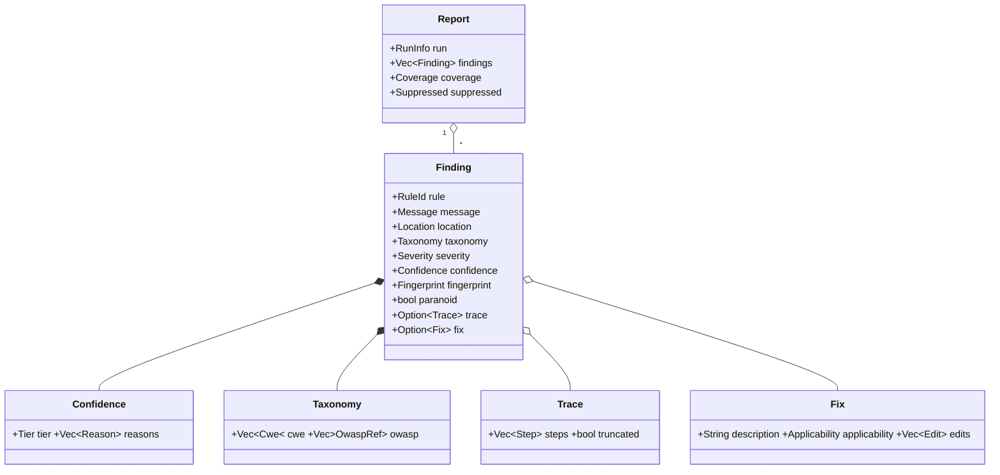
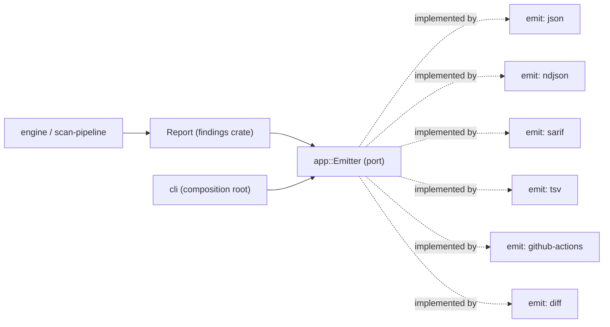
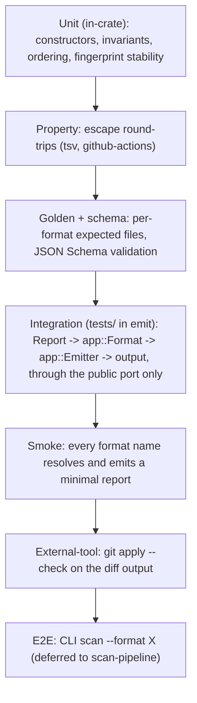

## Context

The scaffold is applied: `bleedthrough-findings` (domain) and `bleedthrough-emit` (infrastructure) exist as empty skeletons; `architecture.toml` lets `findings` depend on nothing in the workspace, `emit` on `app` and `findings`, and bans serialization-format crates from domain manifests. `bleedthrough-app` is still empty, and the glossary check requires public domain types to name a glossary term. See proposal.md for motivation; the specs `finding-model` and `report-emitters` carry the requirements. Decisions inherited from exploration: confidence is an ordinal tier with reasons (derivation is the engine's job), severity is separate from confidence, stable fingerprints, coverage and suppressed counts are mandatory, emitters are thin, output is deterministic.

## Goals / Non-Goals

**Goals:**
- A domain model whose invariants are enforced at construction, so an invalid finding cannot reach an emitter.
- A versioned wire contract, decoupled from the domain types so the schema can evolve independently.
- Six emitters that are byte-deterministic and verified against a schema and golden files.

**Non-Goals:**
- Producing findings, deriving confidence or severity, reading the baseline, choosing formats on the CLI.
- Colour, pager or human-oriented terminal output (a later, separate concern).
- Streaming a report while the analysis is still running (`Report` is complete before emission).

## Decisions

### D1. Shape of the model

Names are indicative. Fields are private; values are built through validating constructors that return errors (missing taxonomy tag, reason-less confidence below high, overlapping edits, trace not source-to-sink). `Report` is immutable and sorts its findings on construction (path, start, rule, fingerprint). Public enums are `#[non_exhaustive]`, as the scaffold's lints require.

### D2. No serialization in the domain; wire DTOs live in `emit`

The domain types carry no serde. `emit` defines separate, versioned wire types and maps domain to wire. Alternatives: derive serde on the domain (rejected: it couples the public schema to the in-memory model and makes schema evolution a domain change), and a shared contract crate (rejected as one more crate for no current need). The cache and the baseline will do the same with their own formats, so none of them forces a serialization concern into `findings`.

### D3. Fingerprint construction

`findings` defines `FingerprintInput` (rule id, enclosing symbol, normalized key snippets, occurrence index) and hashes a canonical, length-prefixed encoding with SHA-256, keeping the first 128 bits as hex under a scheme prefix (`bt1:`). The engine is responsible for producing normalized snippets (whitespace and comments removed); `findings` defines only the encoding, so it needs no syntax types and stays free of workspace dependencies. SHA-256 over a faster hash because auditability and stability matter and the cost is irrelevant at this volume. Alternatives: BLAKE3 (fine, but a less conservative choice for a value users will store in baselines), and hashing locations (rejected: unstable).

### D4. Confidence reasons are a closed, documented vocabulary

`ReasonCode` is a non-exhaustive enum with stable snake_case wire codes; the JSON Schema enumerates them. Adding a code is an additive schema change. Unknown wire codes are rejected when reading, which keeps reasons machine-reliable. The initial set mirrors the required list in the spec.

### D5. Severity score without floats

When a score is present it is stored as integer tenths (0 to 100) and rendered with one decimal place. This avoids any float-formatting nondeterminism across platforms and keeps byte-identical output. The vector is an opaque string; its meaning is defined by the rule-schema change.

### D6. The `Emitter` port lives in `app`

Indicative contract: an emitter takes the report, an `EmitContext` (options such as header on or off, annotation cap, and read access to original source text), and a writer, and returns an `EmitOutcome` (a one-line coverage summary for formats that cannot embed it, and the list of fixes that were skipped) or an error. `app` also owns `Format` (name parsing, the `jsonl` alias, the list of valid names); `emit` provides the implementations. The source-reading access in `EmitContext` exists because a unified diff needs context lines; the `scan-pipeline` change wires it to its source repository port. The port is minimal here and may gain members later; that is an API-snapshot change.

### D7. Format specifics

- **json / ndjson:** serde-based wire types in `emit`. NDJSON records carry a `type` tag (`run`, `finding`, `summary`). Maps use ordered keys (`BTreeMap` or ordered structs) so output never depends on hash iteration order.
- **sarif:** a small set of hand-written serde structs for exactly the SARIF 2.1.0 subset we emit, in preference to a third-party SARIF crate, for control over output and one fewer dependency to audit. CWE and OWASP are expressed as `taxonomies` with `taxa`, referenced from rules via `relationships`; the fingerprint goes under `partialFingerprints` with key `bleedthrough/v1`; GitHub's `security-severity` rule property is set from the score or a level default. Coverage becomes `toolExecutionNotifications` and `executionSuccessful`.
- **tsv:** hand-written; fixed column order; escapes `\t`, `\n`, `\r`, `\\`.
- **github-actions:** workflow-command escaping: in messages `%`, `\r`, `\n` become `%25`, `%0D`, `%0A`; in property values additionally `:` and `,` become `%3A` and `%2C`. Annotation cap ordering is severity then confidence then the standard finding order.
- **diff:** apply edits to the original text and diff with a text-diff library (`similar`, Apache-2.0) to produce `git apply`-compatible hunks with three lines of context. Edits are checked against the expected original text; overlapping or stale fixes are skipped and reported in the outcome.

### D8. Schema and test strategy

`schemas/report.schema.json` (JSON Schema, 2020-12, hand-written) covers the `json` document and the `ndjson` records. Tests: (1) validate emitter output against it with a schema-validation dev-dependency; (2) golden files per format under `crates/emit/tests/golden/` for a fixed set of reports (zero findings, one finding with trace and fix, mixed severities, an incomplete run, hostile strings with tabs, newlines, percent signs and non-ASCII); (3) property tests for the escaping of tsv and github-actions (escape then unescape equals the original); (4) a fingerprint stability suite. `findings` unit tests cover construction invariants and ordering; no serialization appears in the domain tests.

### D9. Test strategy for this change

- **Integration** tests live in `crates/emit/tests/` and use only the public `app` port and `Format`, exactly as the CLI will, so a layering or wiring mistake fails here and not later.
- **Smoke** tests are the cheapest check that every shipped format name is wired to an emitter and produces non-empty valid output for a minimal report; they run on every CI build.
- **E2E** is deliberately not in this change: no pipeline or CLI wiring exists yet. `scan-pipeline` owns an e2e test per format that runs the real binary against fixture projects and compares to the same golden files, so goldens are shared and cannot drift between layers.
- Project-wide rules (where each kind of test lives, which are required, how a golden update is reviewed, the fixture corpus and e2e harness) belong to `corpus-and-benchmarks`; this change follows conventional Rust layout (`tests/` for integration, `tests/golden/` for fixtures) so adopting those rules later needs no moves.

### D10. Glossary and architecture bookkeeping

`docs/glossary.md` gains Report and Trace. Domain types name their terms; helper and error types use `Term: exempt`. `api/bleedthrough-findings.txt` and `api/bleedthrough-app.txt` are regenerated and reviewed. `architecture.toml` needs no edge changes.

## Risks / Trade-offs

- [Domain/wire mapping code is extra work and a place for drift] -> golden and schema tests catch drift; the mapping is mechanical.
- [A fixed reason vocabulary may miss cases the engine finds] -> adding a code is additive; the engine change may extend it before release.
- [GitHub annotation limits are enforced by GitHub, and the current numbers must be checked rather than remembered] -> the cap is configurable; the default is set from GitHub's documentation during implementation.
- [Vendoring the official SARIF schema for validation may have licence implications] -> verify the schema's licence before vendoring; the fallback is structural assertions on required fields and a vendored copy only if permitted.
- [Diff output depends on source text still matching the analysis] -> expected-original checks skip stale edits and report them rather than corrupting a patch.
- [An early `Emitter` port may be reshaped by `scan-pipeline`] -> the port is deliberately small and covered by the API snapshot, so changes are visible.
- [No e2e coverage until the pipeline exists] -> integration and smoke tests exercise the real port now; the e2e per format is a recorded handoff to `scan-pipeline` that reuses these golden files.

## Migration Plan

Greenfield: nothing consumes a report yet, so there is no migration. Rollback is reverting the change. Schema version starts at 1; the first breaking change after release will bump the major version.

## Open Questions

- Exact default value of the GitHub annotation cap (resolved from GitHub's documentation while implementing; it does not change the spec).
- Whether the SARIF schema can be vendored for validation (see Risks); the tests are written to degrade to structural checks.
