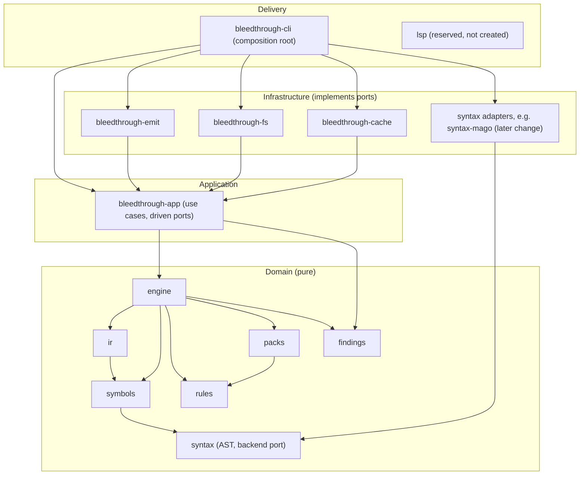
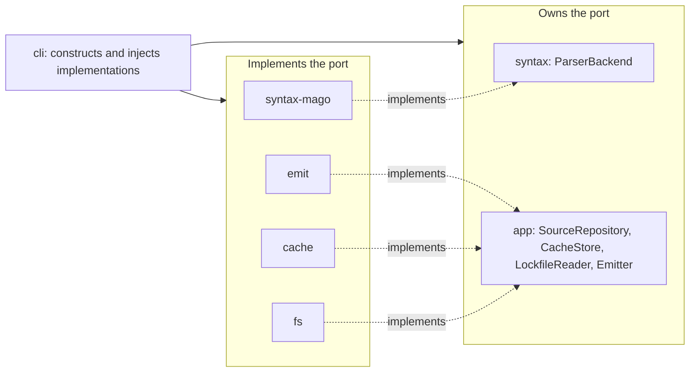
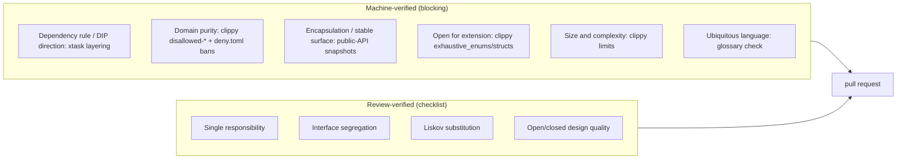

## Context

Empty repository apart from OpenSpec scaffolding. Rust 1.99.0 is installed locally; the planned parser backend (`mago-syntax` 1.57, `MIT OR Apache-2.0`) declares MSRV 1.99.0 / edition 2024. See proposal.md for motivation. Exploration decided: owned AST with swappable parser adapters, own symbols/types/IR/taint engine, engine as a library under thin front-ends, per-library packs, DDD with SOLID, and "safe, sound, trustworthy over fast to ship".

## Goals / Non-Goals

**Goals:**
- Make the DDD layering and domain purity compile-time and CI-enforced from the first commit.
- Be honest about what CI proves: separate machine-verified rules from review-verified ones.
- Keep the scaffold free of runtime dependencies so later changes choose theirs deliberately.
- One place for toolchain, lint, layering and license policy.

**Non-Goals:**
- Any analysis, parsing, rule, pack or output behaviour.
- Choosing serialization, CLI-parsing or async libraries (decided in the changes that need them).
- Release or packaging automation.

## Decisions

### D1. Four layers, one crate per concern

Edges not drawn for readability are listed in `architecture.toml` (e.g. every crate above may depend on domain crates it uses; `emit` depends on `findings`; `fs` on `rules` and `packs`; `cache` on `engine` and `symbols`; `app` on `syntax`, `symbols`, `rules`, `packs`). `syntax`, `rules` and `findings` depend on no workspace crate.

DDD mapping: bounded contexts are the domain crates; parser adapters are the anti-corruption layer for third-party parser types; rules and pack manifests are the published language between knowledge and engine; `Finding`, `Fingerprint`, `Confidence`, `Coverage` are value objects in `findings`. Pack hooks are plain serializable data, so `packs` never sees AST types (keeps the WASM option open).

Alternative considered: a single `core` crate with modules. Rejected: boundaries would be conventions, purity could not be checked per crate, and parser isolation could not be proven by the dependency graph.

### D2. Ports are owned by the inner layer; the CLI wires

This is dependency inversion made structural: the direction of dependency in the Cargo graph is the direction of the abstraction. Port names above are indicative; their definitions belong to the changes that introduce each port.

### D3. Layering declared once, checked by `xtask`

`architecture.toml` lists each crate with its layer and its permitted workspace dependencies. `cargo xtask check-layering` reads `cargo metadata` and fails on undeclared edges, unlisted crates, upward dependencies, and cycles. Alternatives: a shell/Python script (extra runtime for contributors) and `cargo-deny` alone (cannot express intra-workspace direction).

### D4. What CI verifies and what review verifies

The review checklist is `docs/architecture-review.md`, referenced by the PR template. `docs/architecture.md` lists every principle with its verification method and states that green CI does not demonstrate the review-only ones. Interface segregation could be partially proxied by a trait-method-count limit; we deliberately do not, to avoid gaming a number.

### D5. Domain purity mechanism

- Per-domain-crate `clippy.toml` with `disallowed-types` and `disallowed-methods` for `std::fs`, `std::net`, `std::process`, `std::env`, `std::time::SystemTime`/`Instant`, and `std::thread::sleep`.
- `deny.toml` bans infrastructure crates (directory walkers, HTTP clients, async runtimes, format crates such as JSON/TOML parsers) from domain manifests via per-crate rules in the layering check; serde derive support is allowed since data-contract derives do no IO. Format crates live in `emit` and `fs`.

### D6. Public-API snapshots

Snapshots of each domain and application crate live under `api/` and are compared by `cargo xtask check-api`. The project is stable-only (no nightly anywhere in CI), so the extractor walks each crate's source with `syn` and records its `pub` items (module path, kind, signature text) and public re-exports. Trade-off: this is weaker than rustdoc JSON, because macro-generated items and complex glob re-exports are not fully resolved; the check documents this limit and the review checklist covers it. Alternatives rejected: `cargo-public-api` (needs nightly rustdoc JSON, ruled out by the stable-only decision), `cargo-semver-checks` (compares against a published release, and crates are not published), `RUSTC_BOOTSTRAP` hacks (undermine the exact toolchain pin), and hand-written `pub` audits (not mechanical).

### D7. Glossary check

`docs/glossary.md` is the glossary. `xtask check-glossary` scans public type declarations in domain crates and requires a doc line `Term: <name>` naming a glossary term, or `Term: exempt` for non-concepts. It does not judge naming quality. Structured doc lines were chosen over naming conventions because they are checkable and explicit.

### D8. Toolchain and policy files

`[workspace.package]` carries edition 2024, `rust-version = "1.99"`, license and repository; `[workspace.lints]` carries `unsafe_code = "forbid"` and clippy levels; every crate inherits both. `rust-toolchain.toml` pins `channel = "1.99.0"` with `rustfmt` and `clippy`. Exact pin over floating `stable` so CI and contributors cannot drift when stable moves. Single MSRV chosen over "core low, adapter high": the project ships binaries (GitHub Releases and a Docker image), not crates, and one version removes CI matrix burden. Every crate sets `publish = false` through workspace metadata; nothing is published to crates.io, so crate names and library API semver are not a v1 concern.

### D9. License and dependency policy

`MIT OR Apache-2.0`, with `LICENSE-MIT` and `LICENSE-APACHE`. The `deny.toml` allow-list starts with MIT, Apache-2.0 (and with LLVM exception), BSD-2/3-Clause, ISC, Unicode-3.0, Zlib, and is extended only by explicit review. Copyleft and unknown licenses are denied. Parser-backend crates are banned except through the adapter crate as a declared wrapper, and exact-pinned there.

### D10. CI on GitHub Actions

One workflow, required jobs: build+test, fmt, clippy (`-D warnings`), deny, layering, glossary, public-API. Every job uses the pinned 1.99.0 toolchain from the pin file, the single source of truth; there is no nightly job. Release automation (binaries, Docker image) is out of scope here and belongs to a later change.

### D12. Own repository on GitHub

`bleedthrough/` currently sits untracked inside the parent `~/projects` repository. The project gets its own git repository with a GitHub remote, so CI, releases and history are independent. Creating the remote repository is an outward-facing action and is confirmed with the user when the task is applied.

### D11. Skeleton crates carry docs, not code

Each crate has a crate-level doc comment (layer, responsibility, allowed dependencies mirroring `architecture.toml`), an empty public surface, and one smoke test. The CLI prints its version and exits 0.

## Risks / Trade-offs

- [Nine-plus crates before any logic exists] -> accepted; the split encodes decisions already made, and merging crates later is cheaper than splitting them.
- [Stable-only API check is weaker than rustdoc JSON] -> documented limits (macros, glob re-exports) in the check and spec; private-by-default and the review checklist cover the gap.
- [Clippy `disallowed-*` can be bypassed via re-exports or other crates] -> backed by manifest bans and review; documented as a proxy, not proof.
- [Glossary check measures presence, not quality] -> stated in the spec; naming quality is in the review checklist.
- [Layering file drifts from reality] -> the check fails on unlisted crates and undeclared edges, and new permitted edges need a comment justifying them.
- [Single MSRV of 1.99 limits library reuse] -> accepted; crates are unpublished (D8).
- [`cargo-deny` and its advisory DB need network in CI] -> acceptable; local runs may use `--offline` with a fetched DB.

## Migration Plan

Greenfield: no migration. Rollback is reverting the commit. Later changes add content to the reserved directories, define the ports named in D2, and extend `architecture.toml`.

## Open Questions

- Whether `xtask` later hosts further repo automation (corpus runners, schema export) is decided when that need appears.
