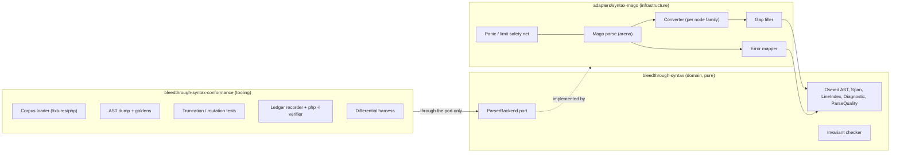
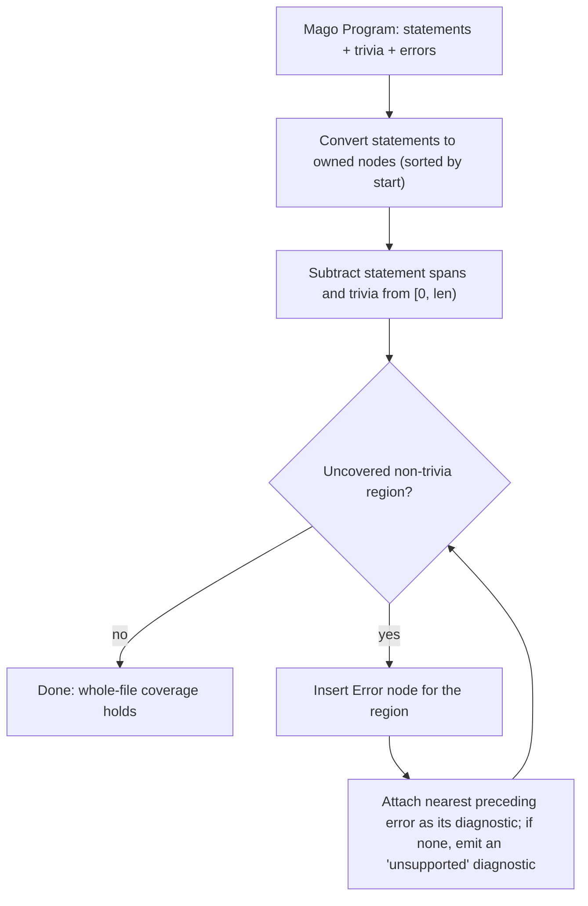
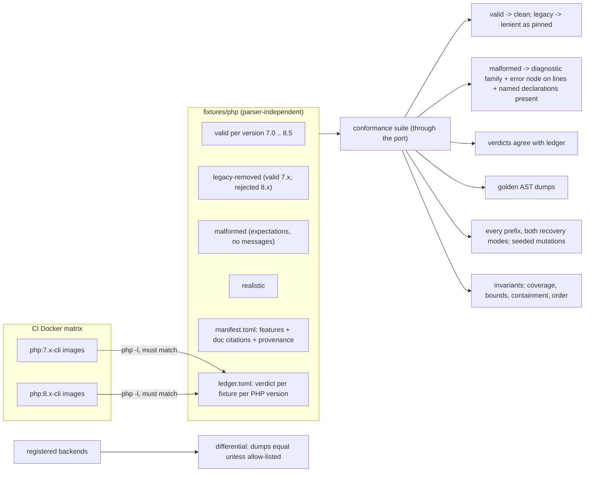

## Context

The scaffold and the finding model are applied. `bleedthrough-syntax` is an empty domain skeleton (no workspace dependencies, `exhaustive_*` lints on); `adapters/` is an empty reserved directory; `architecture.toml` supports `adapter = true` crates and a `parser_backends = ["mago-*", ...]` policy that `xtask` enforces for direct manifest dependencies and exact pins; `deny.toml` bans `mago-syntax` and `mago-database` outside `bleedthrough-syntax-mago`. Clippy limits are tight (cognitive complexity 15, 80 lines per function, 5 arguments), which shapes how a large AST conversion must be written. See proposal.md for motivation and the four specs for requirements.

What inspecting `mago-syntax` 1.57.0 established (observed in the crate source, not assumed):
- `parse_file*` returns `&Program` with `statements`, `trivia` and `errors`. The top-level loop pushes a statement on success and an error on failure and moves on, so a statement that fails to parse yields **no node at all**, however large it is. A stuck loop skips one token and records an error, leaving a one-token gap.
- `ParserSettings` has `recover_incomplete` (keep unfinished bodies and lists at end of file, still report missing delimiters) and short-tag handling; it has **no PHP version**. The parser is version-permissive.
- The CST has property hooks, `pipe`, `partial_application`, `match`, enums and attributes; `Statement` has about 32 variants and `Expression` about 33. These enums are not marked non-exhaustive.
- `ParseError` variants: syntax error (unexpected or unrecognised token, unexpected end of file, recursion limit), unexpected end of file with expected tokens, unexpected token, unclosed literal string, recursion limit exceeded.
- Dependencies of `mago-syntax`: `mago-allocator`, `mago-database`, `mago-php-version`, `mago-reporting`, `mago-span`, `mago-syntax-core`, `memchr`, `ordered-float`, `paste`, `strum`. Through them: `notify`, `walkdir`, `glob`, `globset`, `rayon`, `tracing`, `regex`, `blake3`, `serde_json`, `serde-sarif`, `schemars`, `ariadne`, `codespan-reporting`, `termcolor`. All Mago crates are `MIT OR Apache-2.0`, MSRV 1.99.0.
- The Mago team's own `editor_recovery` test shows the `recover_incomplete` behaviour on truncated input, and the crate's dev-dependencies include tree-sitter, so a second backend for differential testing is plausible later.

## Goals / Non-Goals

**Goals:**
- A syntax model with no third-party types, complete for PHP 8.0 to 8.5, in which no source byte is ever silently lost.
- A port any backend can implement, and an adapter proven by an independent oracle, resilience tests and a measured spike.
- Make the dependency cost and the conversion cost visible before the larger changes depend on them.
- Provide a parser-independent fixture corpus with an interpreter-verified ledger, so any parser change or replacement is judged on the same evidence.

**Non-Goals:**
- Name resolution, types, docblock content parsing, IR lowering.
- PHP-version gating of syntax.
- Sub-statement error recovery beyond what the backend offers.
- A second backend, and the large fixture corpus and benchmark suite.

## Decisions

### D1. Shape: where each piece lives

The conformance crate is a workspace member in a new **tooling** layer entry allowed to depend only on `bleedthrough-syntax`; adapters use it as a dev-dependency. This keeps test machinery (process spawning for the oracle, file reading) out of the pure domain crate. The task list includes verifying how `check-layering` treats dev-dependency edges and declaring or exempting the edge explicitly.

### D2. The AST is an owned tree

Owned nodes (`Box`, `Vec`, `Box<str>`), no lifetimes, immutable, `Send + Sync`. Rationale: Mago's arena and lifetimes cannot cross the port, the cache and the LSP both want values that outlive a parse, and threads share trees freely. Alternatives: an arena of nodes addressed by index (better locality and cheaper to serialise, but a more demanding API and an easy place to leak identity bugs), and re-exporting the backend's tree (rejected: it defeats the whole facade). The cost of ownership is allocation; the spike measures it against a provisional limit (D9), and an index-based arena remains a drop-in later because consumers see accessors, not representation.

### D3. Node vocabulary and the no-drop rule

Node families: `Stmt`, `Expr`, `Decl` (class-likes and members, functions), `TypeHint`, `Name` (with qualification kind), `Literal` (raw text, interpolation parts), `Attribute`, `Param`. `Unsupported { kind, span }` and `Error { diagnostic, span }` are variants in every position where arbitrary syntax can occur (statement, expression, class member, type), so the model can represent a hole wherever one appears. A visitor and a children iterator are provided; the invariant checker (whole-file coverage, bounds, containment, order) is built on the iterator and is public so the conformance crate can apply it to any tree.

### D4. Spans and line index

`Span { start, end }` as `u32` byte offsets, so the maximum file size is bounded by the options (D8). `LineIndex` maps offsets to 1-based line and column; columns count Unicode scalar values and each invalid UTF-8 byte counts as one, matching the finding model's location rule so reports never need a second conversion.

### D5. Gap filling

This handles both the dropped statement (the whole class vanishes) and the one-token skip. Errors are assigned to the gap containing their start offset, otherwise the nearest preceding gap. If a gap has no Mago error (an unexpected state), the adapter still produces the Error node with a synthetic diagnostic rather than hiding it. Known limit, accepted for this change: one syntax error inside a large class still replaces the entire class with an Error node, because the backend discards it; downstream this lowers confidence and is counted in coverage. Re-parsing a failed class member by member to salvage the rest is possible future work and not attempted here.

### D6. Quality and diagnostics

Quality: `clean` if there are no diagnostics and no unsupported nodes; `failed` if there is no usable tree (for example input too large, backend panic, or every statement lost); otherwise `recovered`. Diagnostic code mapping:

| Mago error | Project code |
|---|---|
| syntax error: unexpected or unrecognised token; unexpected token | `unexpected_token` |
| unexpected end of file (both forms) | `unexpected_eof` |
| unclosed literal string | `unclosed_string` |
| recursion limit exceeded (both forms) | `recursion_limit` |
| panic caught | `backend_failure` |
| input over limit | `input_too_large` |
| node with no representation | `unsupported_construct` |

### D7. Conversion is exhaustive by construction

The converter is organised in one module per node family so that every function stays under the project's size and complexity limits, and every `match` over a Mago enum lists all variants with no wildcard arm. The pinned crates' enums are not non-exhaustive, so a version bump that adds a variant breaks the build, which is exactly the guard the spec requires. Constructs the model has no node for are converted to `Unsupported` explicitly, so adding support later is a local change, and the unsupported count in the spike report shows what is unmapped.

### D8. Safety net, limits and identity

Each parse runs under `catch_unwind`, with a fresh arena per call (no shared mutable state, so the adapter is trivially `Send + Sync`). A panic yields a `failed` result with `backend_failure`. The release profile must unwind (not abort) for this to work; a task verifies the profile and adds a test that proves the net catches a forced panic. The port's `ParseOptions` carry `short_tags`, `recovery` (strict or editor) and `max_bytes`; the default `max_bytes` is provisional at 8 MiB, an assumption to confirm. Identity is the backend name `mago-syntax` plus the exact pinned version, read from the manifest at build time and compared in a test with the lock file.

### D9. Pins, isolation and footprint

The adapter pins `mago-syntax`, `mago-span`, `mago-database` and `mago-allocator` with exact `=1.57.0` requirements (the pins xtask already checks for `mago-*`), and the committed `Cargo.lock` is enforced with `--locked` in CI. Pinning only `mago-syntax` is not enough: its own requirement on its siblings is a caret range, so a lock update could mix versions; pinning every direct Mago dependency prevents that. For isolation of transitive Mago crates, `deny.toml` `wrappers` lists only direct dependents and is awkward for a crate family, so the layering check gains a reachability test over the resolved dependency graph: no workspace crate other than the adapter, and the tooling crate if it needs none, may reach any `mago-*` crate. Direct bans for `mago-syntax` and `mago-database` stay. The full closure goes through `cargo deny check`; the spike report lists the crates and licences. Alternative considered: depend on tree-sitter-php instead for its smaller footprint. Not chosen now, since it provides a generic CST and no typed AST, but the port keeps it as a future second backend and the first differential-testing partner.

### D10. Fixture corpus, ledger and conformance suite

- **The corpus is data.** It is independent of any parser and of our AST, so a new backend, a tree-sitter adapter, or a parser we write ourselves is tested against the same files. Goldens, which depend on our owned AST, live beside the suite and not in the corpus.
- **Layout:** `fixtures/php/{v7.0..v8.5, legacy-removed, malformed, realistic}/`, with `manifest.toml` (feature, documentation page cited, group, purpose, provenance and licence, and for malformed files the expectation block) and `ledger.toml`. Syntax-check fixtures stay separate from the vulnerability fixtures that `corpus-and-benchmarks` will add.
- **Ledger:** one verdict (`valid` or `invalid`) per fixture per PHP version from 7.0 to 8.5, with interpreter version and date. A CI job runs `php -l` in the official image for each version and fails on any disagreement; versions with no obtainable image are listed as unverified with a reason, never as verified. Local runs without a given interpreter rely on the ledger and say so. Authoring tooling for the ledger is a small command in the conformance crate that runs the interpreters available and writes verdicts, so recording them is mechanical.
- **Legacy policy (decided):** syntax valid in 7.x and rejected by 8.x is parsed leniently, so legacy code can be analysed. Each such fixture is tagged in the manifest with the pinned lenient behaviour; the golden dump records the tree. The 8.x interpreter rejecting it is expected and does not fail the suite. Alternative rejected: mimic PHP 8 exactly, which would erase regions of legacy files from analysis.
- **Malformed expectations are backend-neutral:** diagnostic code family, a covered line range for the error node, and a list of declarations that must survive. This detects the "whole class disappeared" failure on any parser and does not freeze a particular parser's recovery shape.
- **Feature lists** for 7.0 to 8.5 come from the official PHP documentation while authoring, with the page cited per feature, never from memory. Fixtures are original, small (at most 200 lines unless realistic) and one feature each.
- **Mutations** use a small deterministic generator written in the conformance crate (no new dependency), seed recorded in failure messages.
- **Golden dumps:** an S-expression-style text with kind, span and escaped literal text, deterministic.
- **Version scope:** analysis targets 8.0 to 8.5 (earlier decision); 7.x is covered in the corpus and by lenient parsing only so that legacy files do not lose regions. No promise is made that 7.x semantics are analysed correctly.

### D11. The spike

Run the suite and a measurement example (`examples/spike.rs` in the adapter, using the standard clock and the Linux process status file for memory; no benchmarking dependency) over the fixtures, a generated large file, and, locally and uncommitted, one or more real open-source PHP projects for realistic numbers. Report to `docs/spikes/syntax-mago.md`. Provisional criteria, to be confirmed by the project owner when reviewing the report:

| Criterion | Provisional rule |
|---|---|
| Coverage | Every valid 8.0 to 8.5 fixture parses clean; anything Mago cannot parse is listed as a finding, not hidden |
| Recovery | Zero uncovered non-trivia bytes after gap filling on the mutation corpus; count of regions made explicit is reported |
| Conversion cost | Parse plus convert at most 2x the parse-only time on the same corpus (an assumption, to be agreed) |
| Memory | Peak resident memory recorded; no hard limit |
| Footprint | Closure passes licence and advisory checks; crates listed |

A failing criterion does not abort the change: it produces a recommendation (accept, adjust the representation, or reconsider the backend) that the owner decides.

### D12. Upgrade procedure

A short `docs/` page states how to bump Mago: change all pins together, rebuild (new variants fail to compile), run the suite, review golden diffs, re-run the spike measurements, and update the report.

## Risks / Trade-offs

- [Large transitive footprint (file watching, regex, SARIF, terminal crates) for a parser we only partly use] -> audited and listed in the spike; isolated in one crate; a lighter backend stays possible behind the port.
- [A syntax error removes a whole class from the tree] -> made explicit as an Error node, counted in coverage, and lowers confidence downstream; salvage recovery is future work.
- [Conversion may be costly] -> measured against a provisional limit; the owned representation can change to an index arena without touching consumers.
- [Weekly Mago releases break the exhaustive conversion] -> pins, and the upgrade procedure; breakage is loud, not silent.
- [Local PHP is 8.4, and an official image may not exist for every version, especially the newest] -> the ledger carries the verdicts, CI verifies every version it can obtain, and unobtainable versions are listed as unverified, never as verified; the task list checks image availability first.
- [Lenient parsing of removed 7.x syntax could hide a real error in 8.x code] -> it is limited to constructs where the tree is unambiguous, pinned per fixture, and visible in the golden dumps.
- [A ledger mistake would silently bless a wrong expectation] -> the ledger is re-verified against real interpreters in CI, so it cannot drift without a failing job.
- [Panic catching needs unwinding] -> verified by a test; if the profile aborts, the net is useless, so this is checked first.
- [Dev-dependency edge from the adapter to the tooling crate may conflict with the layering check] -> resolved explicitly in the first tasks.
- [`u32` offsets cap file size] -> bounded by `max_bytes`, far below 4 GiB.

## Migration Plan

Greenfield: nothing consumes the model yet, so no migration. Rollback is reverting the change. `Cargo.lock` gains the Mago closure. If the spike returns a no-go, the port and the owned AST still stand and only the adapter is replaced or revised.

## Open Questions

- Confirmation of the provisional criteria in D11, especially the 2x conversion limit and the default 8 MiB input limit; they do not change the specs and the spike will show whether they are sensible.
- Whether PHP-version gating (flagging syntax newer than the configured version) belongs in `symbols-and-types` or the engine; the model deliberately stays permissive.

## Implementation Notes

Findings made while implementing; none changes a spec requirement, each refines a design decision.

- **D5 refinement, per-sequence gap filling.** Mago drops unparseable statements inside nested statement lists (namespace bodies, function and method bodies, case bodies), not only at the top level. The gap filler therefore runs on every statement sequence, bounded by that sequence's delimiters, and emits an `Error` statement with the nearest diagnostic (or a synthesized one) for any region that is not whitespace, a comment or a converted statement.
- **Stack safety, one thread per parse.** Mago recurses once per nesting level; with a 2 MiB thread stack a debug build overflows at about 300 nested parentheses, and a stack overflow aborts the process (`catch_unwind` cannot help). The adapter runs each parse on a scoped thread with a 64 MiB reserved stack and converts a failed spawn or a panic into a `Failed` result. The converter additionally caps its own depth at 200 and emits `Error` nodes beyond it, so the tree stays safe to walk, compare and drop on any thread.
- **`Statement` and `Expression` are `#[non_exhaustive]` in Mago.** The compiler requires one wildcard arm in those two matches; it is the `Unsupported` conversion, with the lint allowed on that function only. A variant added by an upgrade is reported by the conformance suite rather than failing the build. All other Mago enums are matched exhaustively with the wildcard lint denied.
- **Layering.** Tooling crates may depend on domain crates, and a dev-dependency from an adapter into a tooling crate is exempt from the "no normal dependency on tooling" rule (owner decision recorded in the session; `architecture-boundaries` gains a delta for this).
- **Depth cap.** The converter stops at nesting depth 512 and emits `Error` nodes with a recursion-limit diagnostic beyond it. Measured on a 2 MiB debug-build thread, deriving `Clone` and `PartialEq` over a left-nested chain overflows between 500 and 1000 levels, so the original cap of 300 kept a margin of 2x; the owner raised it to 512, which still passes the 2 MiB clone/compare/drop test but has a thinner margin; a valid expression of more than about 500 chained operators is therefore reported as recovered rather than parsed clean. Raising the cap, or flattening associative chains in the model, is an owner decision (see the spike report).
- **List coverage.** `check_invariants` checks whole-file coverage at the top level and, for every statement or member list, that nothing but whitespace and comments lies between neighbours. Bytes before the first or after the last item of a nested list cannot be told from the list's own delimiters, so those are covered by the adapter's gap filler (bounded by the delimiters) and by structural tests, not by the invariant.
- **Feature unification.** Mago's closure switches on `serde_json/preserve_order` (through `schemars`), which changes the key order of `serde_json::Value` objects for every crate in the same build. The SARIF emitter relied on sorted keys and its golden test failed in workspace builds; it now sorts all objects itself, which keeps its output byte-identical in both configurations.
