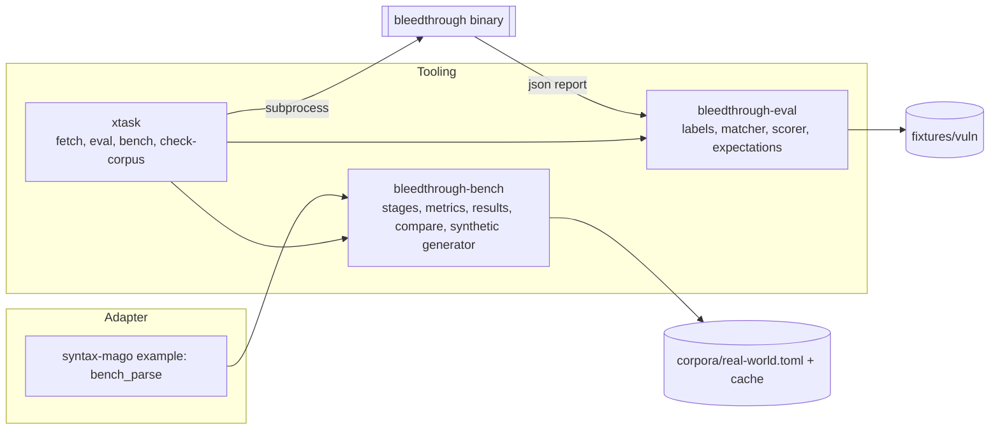
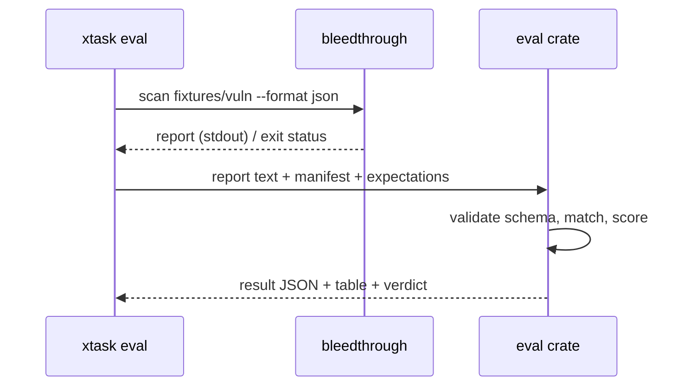

## Context

See proposal.md for motivation. Current state, observed in the repository:

- `fixtures/php/` is the syntax corpus (manifest, ledger, goldens in `crates/syntax-conformance`). Its README reserves a separate place for vulnerability fixtures.
- Tooling crates may depend only on domain crates (`architecture.toml`); `bleedthrough-syntax-conformance` and `bleedthrough-builtins-gen` run through adapter examples as dev-dependencies. `xtask` is tooling and may start processes.
- `unsafe` is forbidden workspace-wide. `cargo deny` governs dependencies and licences. CI has a single required `ci` status; there is one workflow, `ci.yml`.
- The `json` report (`schemas/report.schema.json`) carries findings with `rule`, `location`, `taxonomy` (CWE), `confidence` and a `coverage` block. The CLI has no scan command yet. `symbols-and-types` is planned but not applied, so no symbol stage exists.

## Goals / Non-Goals

**Goals:**
- Make detection quality and speed measurable before the engine and rules exist, with a contract later changes plug into.
- Keep required CI offline, deterministic and fast; keep noisy or networked work out of the merge path.
- Score through the public report so the evaluator survives engine rewrites and tests the agent-facing contract.

**Non-Goals:**
- Writing rules, the engine or the scan command, or choosing the v1 CWE scope (the catalog change owns that).
- Comparing against other SAST tools, or publishing benchmark results externally.
- Fuzzing (the syntax suite already has mutation robustness) and profiling tooling beyond the harness.
- Any change to the product crates.

## Decisions

### D1. Two tooling crates, black-box where possible

`bleedthrough-eval` depends on `bleedthrough-taxonomy` (CWE validation) and `bleedthrough-findings` only; the report is read as JSON text and checked against the schema, so it does not link the engine. `bleedthrough-bench` is generic over `ParserBackend` for the parse stage (same pattern as the conformance suite and the built-in data generator) and the Mago adapter hosts the example that binds it. The end-to-end stage and the accuracy run start the built binary as a subprocess from xtask. No tooling crate depends on the CLI or an adapter. **Alternatives:** one combined crate (rejected: different dependency profiles; eval is needed in required CI and bench is not); in-process engine calls (rejected: ties the evaluator to engine APIs and skips output).

### D2. Vulnerability corpus layout and manifest

`fixtures/vuln/<cwe>/<case-id>/…php` with one `manifest.toml` at `fixtures/vuln/`. Each `[[case]]` declares `id`, `cwe`, `label`, `description`, `php` (version range), `shapes`, `twin`, provenance/licence, and for vulnerable cases `[[case.expect]]` (`file`, `lines`, `min_confidence`), for safe cases `protect` ranges (default whole case). Expectations name CWE, never rule ids (see spec), so rule refactors do not touch the corpus. Framework shapes use small stubs inside the case (`Request`, `PDO` wrappers) so cases need no packages and no Composer installs. `check-corpus` is a pure file/manifest check validating CWE ids with `bleedthrough-taxonomy`. **Alternative:** annotations in comments (`// vuln: CWE-89`) as in some benchmarks: rejected because it pollutes files the tool analyses and is easy to leak into the scan's input.

Shape vocabulary (closed list in the manifest header): `direct`, `local-flow`, `array-element`, `user-function`, `method`, `cross-file-include`, `autoload-class`, `framework-request`, `correct-sanitizer`, `wrong-sanitizer`.

### D3. Matching and metrics

Match key: file, CWE, line-range overlap, confidence at least the minimum. Matching is a greedy assignment on a sorted order so it is deterministic; a finding satisfies at most one expectation, an expectation is satisfied once. Findings in no expectation and outside protected ranges are "unlabelled" (reported, not scored): the corpus labels what we know, and an unknown extra finding in a vulnerable case is information, not a false positive. This avoids punishing correct additional findings while labelled safe twins still catch over-reporting. Per rule metrics use the finding's `rule` field only for attribution, so rule-level numbers exist without rules being in the labels.

Verdicts: `pass`, `fail`, `not-evaluated`. xtask maps them to exit codes 0, 1 and 3; CI maps `not-evaluated` to pass only while `eval/scan-switch` (a committed boolean in `fixtures/vuln/expectations.toml`) is false. The scan-exists change flips it, so absence can never silently become permanent.

### D4. Expectations as a ratchet

`fixtures/vuln/expectations.toml` records per CWE `min_tp`, `max_fp` and the known-gap case ids; `cargo xtask eval --update` rewrites it and prints the diff. Improvements (a gap now passing) fail until recorded: this is the same ratchet used for the parser ledger and stale oracle allowances, so quality moves up only on purpose and stale exceptions cannot accumulate.

### D5. Real-world corpus: pinned archives, cache, no vendoring

`corpora/real-world.toml` lists projects with commit, archive SHA-256 (GitHub-style tarball at a commit), licence, tier. `cargo xtask fetch-corpus [--tier …]` downloads into `$BLEEDTHROUGH_CORPUS_DIR` or `target/corpus/`, verifies, then extracts. Extraction rejects path traversal and symlinks leaving the tree; archives are untrusted data. Selection criteria live in `docs/benchmarks.md` (actively used, PHP 8 era, permissively licensed or at least source-available, mixing framework/non-framework/legacy, spanning tiers); the concrete list and hashes are produced during apply and reviewed. Nothing fetched is committed or shipped, which also avoids a redistribution licence question.

The parse-failure budget (`corpora/parse-budget.toml`) is checked by an xtask command that runs the parser through a generic runner and the adapter example; files PHP itself rejects are excluded with a recorded `php -l` verdict, reusing the interpreter helper pattern from the syntax suite.

### D6. Synthetic generator

A seeded PRNG (same approach as the mutation module in the conformance suite, no `rand` dependency needed) drives templates for classes, functions, controllers and procedural scripts; parameters per the spec. It emits a tree plus an optional label file in the corpus expectation format so the evaluator scores it. Determinism is tested by hashing the output tree. Constructs are restricted to a subset the parser is known to accept, enforced by a test that parses a generated tree with the backend.

### D7. Benchmark metrics: three kinds, gated differently

| Kind | Examples | Stability | Where gated |
|---|---|---|---|
| Structural | file, byte, node counts | exact | required CI (committed baseline) |
| Allocation | alloc count, total bytes, peak live bytes | effectively exact for a fixed input and single thread | required CI (committed baseline, tolerance) |
| Time and memory | median wall time, throughput, peak RSS | noisy, machine-bound | scheduled workflow only, base-vs-head on one runner |

Allocation counting uses the `dhat` crate's allocator in a dedicated mode of the bench binary, so no `unsafe` appears in our code (the allocator lives in that crate; the workspace lint stays `forbid`). It runs single-threaded and on a small synthetic input to stay fast. Peak RSS is read from `/proc/self/status` (`VmHWM`) on Linux and reported unavailable elsewhere. **Alternatives:** instruction counting with valgrind/`iai-callgrind` (most stable timing proxy, rejected for now: external tool and slow, revisit if allocation counters prove too coarse); `criterion` (rejected as the primary harness: statistical comparison across builds is wanted, and criterion's baselines are local to a target directory; it can still be used inside a stage).

### D8. Comparison method

`cargo xtask bench-compare <base-rev> <head-rev>` builds both into separate target directories, then runs them alternately (A B A B …) on each input, so thermal and load drift hits both equally. The report computes medians and a spread (median absolute deviation) from the base samples; a regression requires the relative difference to exceed `max(threshold, k × noise)`. Defaults: threshold 10%, k = 3, 10 timed iterations after 3 warm-ups, tunable per input. Results record CPU model and core count; comparison across different environments is refused unless `--force`.

### D9. Workflows

Required `ci.yml` gains: `corpus` (manifest check, no network), `accuracy` (scorer unit tests; evaluation with `not-evaluated` handling), `bench-counters` (structural and allocation baselines on a small synthetic tree). A new `bench.yml` (schedule + `workflow_dispatch`) fetches the real-world corpus (cached by pin), runs the parse-failure budget, robustness/determinism checks when a scan exists, the wall-time comparison against the previous successful scheduled commit, uploads result documents, and writes a step summary. It is not in the `ci` job's `needs`.

### D10. Result and expectation formats

TOML for human-edited inputs (manifests, expectations, budgets, pins) consistent with the rest of the repository; JSON with explicit `schema_version` for machine outputs (evaluation result, benchmark result). Both have JSON Schemas under `schemas/` so agents can consume them. All writers sort keys and use fixed number formatting so equal data is byte-identical.

## Risks / Trade-offs

- [The corpus encodes the authors' idea of vulnerable] → provenance for every case, a mandatory safe twin, a shape-coverage report, and a review rule in CONTRIBUTING that a label disputed in review is resolved by citing a CWE definition or a documented exploit path.
- [Small cases overstate quality on real code] → the real-world corpus catches crashes, parse failures and determinism, and labelled synthetic trees test scale; precision on real code is a future manual-triage exercise, out of scope here.
- [Overfitting rules to the corpus] → expectations are by CWE with twins, unlabelled findings are surfaced, and the catalog change is expected to add held-out cases.
- [Allocation counts vary by Rust or dependency version] → tolerance on the baseline, baseline update is one command, and the toolchain is already pinned.
- [`dhat` slows runs and alters timing] → used only in the separate allocation mode, never for wall time.
- [Scheduled benchmarks on shared runners are noisy] → same-machine alternating comparison with noise-aware thresholds, and nothing blocking.
- [Real-world archives vanish or change] → hash pin fails loudly; replacement is a reviewed edit to the pin list.
- [Real code may contain malicious samples in tests of security projects] → fetched content is treated as untrusted data: never executed, extracted safely, scanned only.
- [`not-evaluated` switch forgotten] → it is an explicit task in the future scan change's checklist (recorded in `docs/evaluation.md`).

## Migration Plan

Purely additive. Apply order: corpus and scorer first (usable with stand-in reports), then synthetic generator and benchmark harness, then real-world pins and workflows. Rollback: remove the new crates, directories and workflow jobs; no product code depends on them.

## Open Questions

- Which projects make the first real-world list, and their size tiers: chosen during apply from the stated criteria and reviewed with the pins (does not change specs or tasks).
- Whether the instruction-count alternative to allocation counters is needed: decided after the first month of scheduled runs show the noise level.
- Initial v1 CWE scope for corpus cases: the first cases cover the OWASP-oriented classes in the taxonomy (injection, XSS, path traversal, deserialization, SSRF, command injection); the catalog change fixes the final list.
