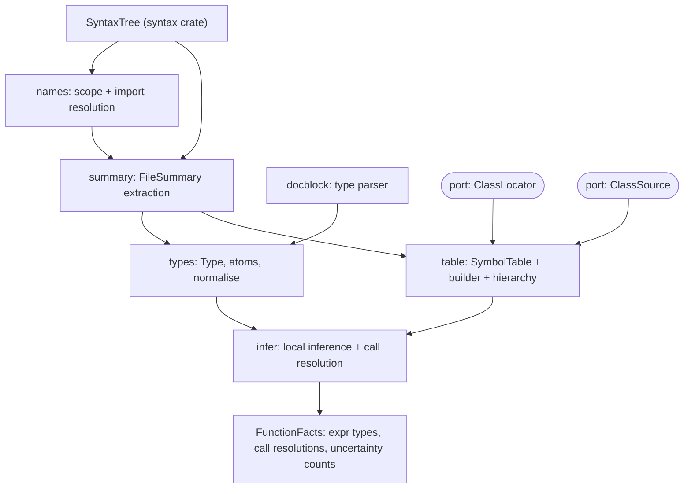
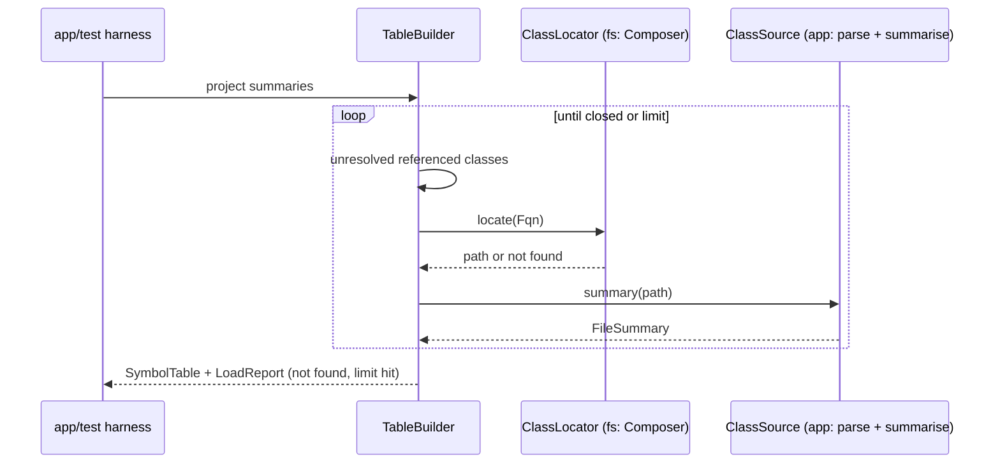

## Context

Observed in the repository:
- `bleedthrough-syntax` is complete: names are `Name { kind, text }` as written, class-likes/functions/params/properties/hooks are nodes, `TypeHint`/`TypeKind` carry native types, docblocks are raw text via `docblock_before`, and every tree has `Unsupported`/`Error` nodes and diagnostics. Spans are byte offsets.
- `bleedthrough-symbols` is an empty skeleton allowed to depend only on `bleedthrough-syntax`; `bleedthrough-cache` already may depend on symbols; `bleedthrough-fs` may depend on app, rules and packs (not symbols yet).
- Mago accepts some invalid code and repairs some errors, so trees can contain synthetic nodes; the symbol layer must tolerate error nodes everywhere.
- Earlier decisions: own name resolution, types and docblock parsing (not `mago-names`, `mago-codex`, `mago-phpdoc-syntax`); Psalm-style inference step; one over-approximating analysis with confidence as the view; PHP 8.0 to 8.5.

## Goals / Non-Goals

**Goals:** resolved names, a deterministic project symbol table with hierarchy and member lookup, a canonical type model with docblock types, local inference that resolves calls with explicit reasons, built-in data loaded from `php-builtin-data`, Composer-based class location, and per-file summaries that a cache can store.

**Non-Goals:** IR, taint flow, inter-procedural return inference, full Psalm/PHPStan language, templates beyond simple substitution, CLI/orchestration, cache storage.

## Decisions

### D1. Module layout inside `bleedthrough-symbols`

One crate keeps the layering unchanged; modules have one responsibility each and clippy limits apply. If the crate grows beyond review size, `types` can later split out as its own domain crate without API change.

### D2. Names

`ResolvedName` is an enum: `Resolved(Fqn)`, `FunctionOrConst { namespaced, global }` (undecidable fallback), `Dynamic`, `Failed(reason, span)`. `Fqn` stores the declared spelling and a lower-cased key for case-insensitive class/function lookup (constants stay case-sensitive, as in PHP). A per-file `Scope` is built once from the namespace blocks and `use` items; resolution is a function of `(Scope, Name, NameContext)` where context is class, function or constant. `self/static/parent` are resolved by the inference/summary stage with the enclosing class-like known, not by the file scope.

### D3. Summaries and the table

`FileSummary` is a plain, owned, serialisable-in-principle struct (no serde in the domain; the cache crate will encode it) built by one pass over the tree. It stores class-likes with resolved parent/interface/trait names, members with native and docblock types already converted to `Type`, plus diagnostics. Its `declaration_fingerprint` hashes a canonical form of declarations only (no bodies, no spans) using `sha2`, accepted as a dependency of the domain like in `findings`. `SymbolTable::build(summaries)` sorts by path, indexes by key, links hierarchy with an explicit visited set for cycle detection, and exposes lookup, subtype and implementor queries. Duplicates: first by path wins, diagnostics list all.

Lazy loading (the vendor decision) is a worklist, not interior mutability: `TableBuilder` starts from project summaries, collects every class name referenced in declarations (parents, interfaces, traits, native and docblock types of members) plus names handed in by the caller for body references, asks the `ClassLocator` and `ClassSource` ports for those not loaded, adds them, and repeats until closed or a limit (files, depth) is hit. The final table is immutable and a pure function of its inputs, which keeps the cache and parallelism simple. Body-only references (a `new Foo()` inside a method) are fed by a cheap pre-pass that lists referenced class names per file in the summary (`referenced_classes`), so vendor classes used only in bodies are still loaded.

### D4. Types

`Type` is a sorted, deduplicated `Vec<Atom>` behind a constructor that normalises; fields are private. Atoms use `Arc`-free owned data with `Box`/`Vec`; sharing optimisation is a later concern. Literal ints/strings keep values up to a length cap (e.g. 256 bytes) then degrade to the non-literal refined atom. Union cap (default 64) widens to `mixed` with a `widened` flag carried in the type, because the engine needs to turn it into the "analysis widened" confidence reason. `Unknown` is an atom with its own absorption rules: `unknown | T` keeps both but sets `has_unknown`. Rendering is Psalm-like text and is parsed by the docblock parser, which gives the round-trip test for free.

### D5. Docblock parser

A hand-written lexer and recursive-descent parser over the tag line text (no regex), with a depth limit, operating on the raw docblock string from the syntax crate. It returns `Result`-free output: `(Option<Type>, Vec<DocDiagnostic>)`. Tag extraction handles multi-line descriptions, `@param` with optional names/variadics/references, and `@method` signatures. Merging rule per spec: docblock accepted when it is a subtype of the native type (needs a `subtype(a, b)` relation on the type model, conservative: unknown relations count as not-refinement, producing the contradiction diagnostic only when provably disjoint, otherwise native wins silently with an informational note).

### D6. Inference

Abstract interpretation over the owned AST (no IR yet): environment maps variable names to `Type`; statements are interpreted in order; branches fork and join; loops iterate to a fixed point with a limit (default 3 passes then widen); `try` joins the pre-state with every point in the block conservatively (pre-state ∪ post-state). Narrowing is implemented as a function `condition -> (env_if_true, env_if_false)` for the documented subset only. Results are stored as `FunctionFacts { expr_types: Vec<(ExprKey, Type)>, calls: Vec<(ExprKey, CallResolution)>, stats }`, where `ExprKey` is `(start, end, kind-tag)` sorted for determinism. When the IR arrives it will either replace this walk or consume `FunctionFacts` by key; this change does not constrain that choice beyond keeping keys stable. Call resolution consults the table with the receiver type and returns candidates; reason codes are a closed enum in `symbols` and a documented mapping to the confidence-reason vocabulary lives in `docs/` (the engine owns the mapping implementation).

Alternative rejected: building inference on a CFG/IR now. The IR is its own change; local inference over the tree is enough for call resolution and avoids designing the IR twice.

### D7. Built-in data (from `php-builtin-data`)

Built-in knowledge is not written in this change. `bleedthrough-builtins` (domain) provides records with version masks and the `BuiltinDataSource` port; `bleedthrough-fs` embeds `stubs/builtin.data` and implements the port; the app (or a test harness here) hands the parsed data to the table builder. `symbols` therefore depends on `bleedthrough-builtins` (declared in `architecture.toml`). Records are loaded with `origin = builtin`; type texts (declared, tentative, docblock-refined) are converted by the type model's parser, with the tentative type used as the return type when the declared one is absent and the docblock refinement merged by the same refinement rule as project code. Lookups take the modelled PHP version and return one of: found, not available in that version, or unknown. A project declaration that collides with a built-in is a diagnostic and does not shadow it. Guard text and the unbundled state are surfaced on the lookup result so the engine can lower confidence for symbols that exist only on some builds. An unknown-built-in report lists functions and classes referenced by project code that the data does not contain. Alternatives rejected: hand-written stubs (incomplete, error-prone for by-reference flags and return types) and parsing PHP stub files at runtime (the data file already carries version masks and guards that PHP syntax cannot express).

### D8. Composer

`bleedthrough-fs` gets a `composer` module: reads `composer.json`/`composer.lock` with `serde_json` (new dependency, infrastructure only, cargo-deny checked), builds an `AutoloadMap` (PSR-4/0 sorted by prefix length then declaration order, classmap as a map, files list), and implements `ClassLocator`. Directory existence checks go through a small `Fs` trait so tests run without disk. Classmap entries given as directories are scanned with sorted enumeration. Composer's optimised-autoloader vendor files (`vendor/composer/autoload_*.php`) are NOT parsed; `composer.json`/lock are the source of truth. Packages are listed from the lock (`packages`, `packages-dev`).

### D9. Layering updates

`architecture.toml`: fs may depend on symbols; symbols stays dependency-free except syntax (+ `sha2` third party like findings; if the xtask domain-purity check forbids it, use a tiny in-crate hasher test vs. explicit allow-list entry, decided at task 1.2). New glossary terms: Symbol table, Fully qualified name, Type, Call resolution, Summary.

## Risks / Trade-offs

- [Docblock subset too small for real code] -> unsupported constructs degrade to native types with informational diagnostics counted in coverage; subset extensible.
- [Lazy vendor closure explosion on large frameworks] -> file and depth limits, limit-hit recorded, body references only expand classes actually referenced.
- [Inference imprecision causes false negatives via unknown receivers] -> unknown is explicit, produces unresolved-call reasons that the engine can treat as over-approximating propagation with lower confidence.
- [Case-insensitivity and autoload case-sensitivity differ on filesystems] -> classes are matched case-insensitively in the table but located with the case written, with a diagnostic if only a differently cased file exists.
- [Built-in data is only as good as its generator] -> verified by the Reflection cross-check in `php-builtin-data`; unknown built-ins referenced by project code are reported.
- [PHP semantic corner cases (trait conflict resolution, enum interfaces, static properties)] -> fixtures per feature in `fixtures/symbols/`, expected tables as golden text dumps.

## Migration Plan

1. Names and summaries; 2. table and hierarchy; 3. types and docblocks; 4. built-in data loading (needs `php-builtin-data` applied); 5. Composer and locators; 6. inference; 7. docs, snapshots, gates. Each step lands with tests; no data migration.

## Open Questions

- Whether `sha2` is acceptable in the symbols crate under the domain-purity rules (see D9); fallback is an allow-list entry.
- Default limits (vendor files, union size 64, loop passes 3, literal cap 256) are provisional and should be confirmed by `corpus-and-benchmarks`.
