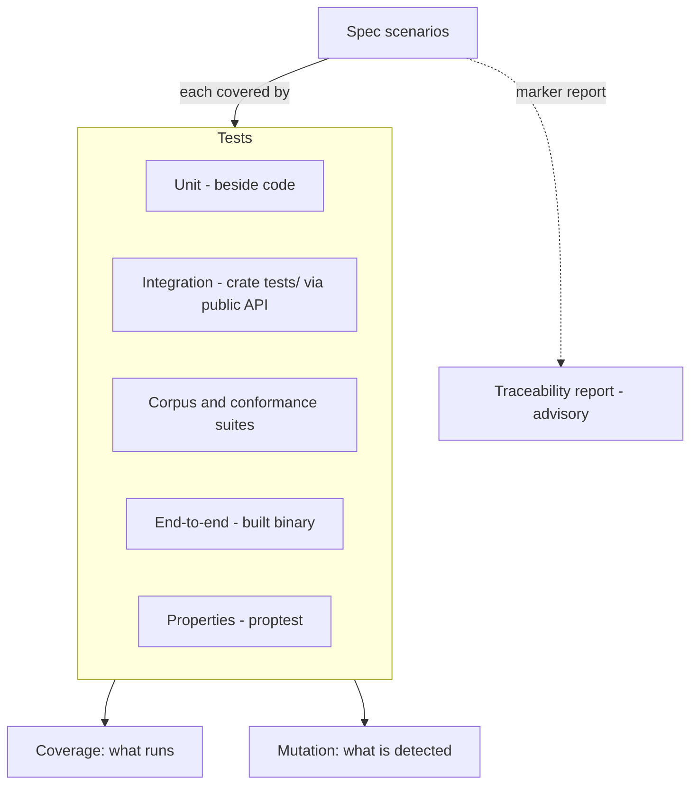
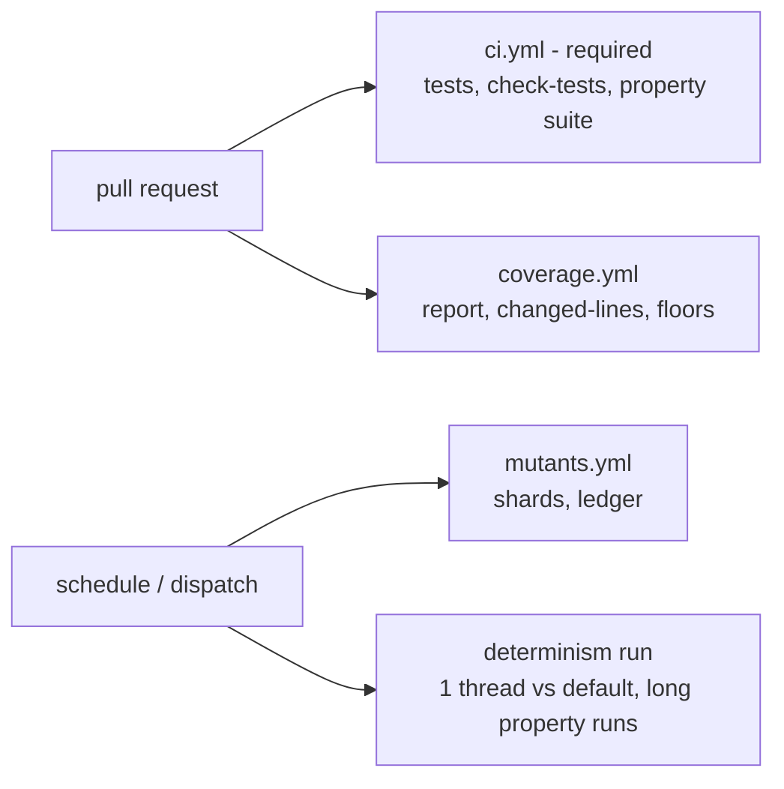

## Context

See proposal.md. Observed state: about 500 `#[test]` functions; shared suites (syntax conformance with a seeded mutation PRNG in `syntax-conformance/src/mutate.rs`, corpus, accuracy, built-in regeneration, API snapshots); one workflow (`ci.yml`) with a single required `ci` status; a second scheduled workflow for benchmarks; toolchain pinned to 1.99.0 with `rustfmt` and `clippy` components and no nightly allowed; layering declared in `architecture.toml` where tooling crates may depend only on domain crates and a dev-dependency on tooling is exempt from the edge rule but the graph must stay acyclic. There is no coverage, mutation, property-testing or traceability tooling.

## Goals / Non-Goals

**Goals:**
- Make test strength measurable (mutation) and test reach visible (coverage), without slowing or destabilising merges.
- Add property testing where invariants exist today and make it standard for new logic.
- Keep every added mechanism reproducible, pinned and ratcheted like existing gates.

**Non-Goals:**
- Fuzzing with coverage guidance (libFuzzer/AFL); revisit with the engine.
- A coverage percentage target for the whole project, or mutation score as a release criterion.
- Rewriting existing tests, except adding markers and properties as described.

## Decisions

### D1. Tools: llvm-cov, cargo-mutants, proptest, plain cargo test

| Need | Choice | Why | Rejected |
|---|---|---|---|
| Coverage | `cargo-llvm-cov` with the `llvm-tools` component | Works on stable, gives line, region and (where supported) branch data, lcov/JSON output | `tarpaulin` (ptrace/engine quirks, weaker on Rust 2024), `grcov` (more setup) |
| Mutation | `cargo-mutants` | Stable toolchain, per-package and diff-scoped runs, stable mutant names, JSON output | `mutagen` (nightly) |
| Properties | `proptest` | Stable, shrinking, persistent regression files, seedable | `quickcheck` (weaker shrinking), `bolero` (heavier) |
| Runner | `cargo test` | No new tool in required CI; keeps the toolchain story simple | `nextest` (optional locally; not required, revisit if flaky reporting is needed) |

`llvm-tools` is added to `rust-toolchain.toml` components on the same 1.99.0 pin: a reviewed pin edit, not a toolchain change. `cargo-llvm-cov` and `cargo-mutants` are installed binaries pinned by exact version in the workflows and documented in `docs/testing.md`; they are never build dependencies. Only `proptest` enters `Cargo.lock`, as a dev-dependency checked by `cargo deny`.

### D2. Layers and the rule that scenarios have tests

Markers are a doc attribute-style comment on the test: `/// spec: <capability>/<Requirement title>`. A scanner in xtask parses `openspec/specs/*/spec.md` for requirement titles and the test sources for markers, then reports uncovered scenarios, stale markers and scenarios covered only by properties. It is advisory because a strict gate over free text titles is brittle and would invite box-ticking; the report is reviewed at archive time (a line is added to the archive checklist). **Alternative:** require a marker per scenario in required CI: rejected for the brittleness above and because existing tests would all need back-filling; instead markers are added as tests are touched and for all new changes.

### D3. Property-testing layout and seeds

A tooling crate `bleedthrough-testkit` (no workspace dependencies, so it can be a dev-dependency of any crate without a cycle) holds generic strategies: PHP identifiers and qualified names, bounded PHP-ish source text, relative paths, version triples, arbitrary byte vectors, a fixed-seed config helper, and the environment settings `BLEEDTHROUGH_PROPTEST_SEED` and `BLEEDTHROUGH_PROPTEST_CASES`. Strategies for a crate's own types live in that crate's tests, and each downstream crate (for example `emit`) writes its own small generators over the public constructors of the types it consumes. This duplicates a little code and keeps the dependency graph acyclic and the public API snapshots untouched. Default case count 256 per property with the whole suite budgeted at 60 seconds extra in required CI; `PROPTEST_CASES` large runs happen in the scheduled workflow. `proptest` regression files are committed beside the tests. **Alternative:** a `testing` feature on domain crates exporting generators: rejected because it widens public API and the API snapshot.

### D4. Coverage

`cargo xtask coverage` wraps `cargo llvm-cov` with the exclusion list in `testing/coverage.toml` (xtask, examples, tests, generated code, `third_party`, `stubs`), emits JSON and a summary table, and `--check` enforces `testing/coverage-floors.toml` (per domain crate, with a margin for the stale-floor rule). PR summary: the scheduled-and-PR workflow `coverage.yml` runs the instrumented suite, posts a job summary and the uncovered changed lines (computed from `git diff` against the target branch and the lcov data). Whether `--check` joins the required status depends on measured cost: if the instrumented run exceeds a 10 minute budget on CI it stays in `coverage.yml` (non-required); decided at apply time and recorded in `docs/testing.md`. Instrumentation does not use nightly.

### D5. Mutation testing

`cargo xtask mutants [--package P] [--in-diff REF]` wraps `cargo mutants` on domain crates only (taxonomy, builtins, syntax, rules, findings, and later symbols, ir, engine, packs), excluding mutants in `Display`/`Debug` impls and logging, with a 60 second per-mutant timeout cap and a fixed order. Missed mutants are compared with `testing/mutants-survivors.toml`: key = crate, file, function, mutation description (line numbers are not part of the key so edits do not churn entries), plus `reason` and `equivalent = true|false`. The security-critical paths in `testing/mutants-critical.toml` (globs) accept only `equivalent = true` entries. The scheduled `mutants.yml` shards by crate, publishes the JSON, and fails on a new survivor or stale entry. First run on existing crates will find survivors: the apply phase fixes high-value ones with tests and ledgers the rest with reasons, which is part of the change's work (group 5). **Alternative:** a mutation-score threshold: rejected, a percentage hides which mutants matter; a ledger names each one.

### D6. Hermeticity and determinism checks

`cargo xtask check-tests` (offline, fast, required) scans test sources for `#[ignore]` without a reason string and for tests that call the interpreter or Docker without being ignored (detected through the existing interpreter helper module and `Command::new("docker"|"php")` in test code outside labelled files) and prints the ignored-test count with reasons. The scheduled workflow runs `cargo test --workspace -- --test-threads=1` and the default run and compares pass sets. Time and locale independence are review-checklist items, not machine-checked.

### D7. Workflows

## Risks / Trade-offs

- [Mutation runs are slow and noisy] → domain crates only, sharded per crate, diff-scoped for PRs, timeouts, nothing blocks merges.
- [First mutation baseline reveals many survivors] → budgeted into apply: fix the critical ones, ledger the rest with reasons; ledger shrinks over time via the stale-entry rule.
- [Coverage floors become a target and invite shallow tests] → floors only ratchet, documentation says coverage is not quality, mutation is the quality measure.
- [Instrumented run too slow for required CI] → a fallback is built into the spec: floors move to the non-required workflow.
- [`proptest` slows the suite or flakes] → fixed seeds, case budget, regression files, reproduction instructions printed.
- [Markers rot] → advisory stale-marker report, reviewed at archive.
- [Pin edit for `llvm-tools` breaks "exactly pinned toolchain" reviewers' expectations] → same channel version; documented in the pin-change note in the change.
- [External tool versions drift] → exact versions in workflows, bumped like any pinned tool.

## Migration Plan

Additive. Order: hygiene check and docs, testkit and first properties, coverage report and floors, mutation baseline, then workflows and traceability report. Rollback: remove the workflows and xtask commands; `proptest` dev-dependency removal is mechanical. No product code is touched.

## Open Questions

- Whether `nextest` is worth adopting for flaky-test retries and per-test timing once the suite is larger: deferred, does not change any spec.
- The branch-coverage availability on 1.99.0 with `cargo-llvm-cov`: verified during apply (task 3.1); the spec already covers the unavailable case.
