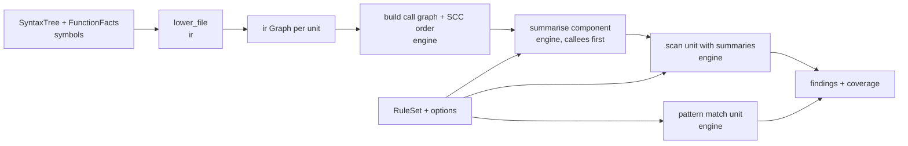

## Context

See proposal.md. Observed state of the repository:

- `bleedthrough-ir` and `bleedthrough-engine` are placeholders. Layering already allows `ir -> symbols, syntax` and `engine -> ir, symbols, syntax, rules, packs, findings, taxonomy`.
- `bleedthrough-syntax` has an owned AST (`ExprKind` with about 40 kinds, `StmtKind`, declarations) and a `walk` visitor. `bleedthrough-symbols` provides `SymbolTable`, `FileSummary`, the `Type` model and `infer_file`, which returns `FunctionFacts`: a type and a `CallResolution` (target kinds, candidates, `UnresolvedReason`) per expression keyed by `ExprKey`. Inference tracks variables only (not properties or array elements) and does not read callee bodies.
- `bleedthrough-rules` gives `RuleSet` with `TaintBody` (sources, sinks with `ArgSel` and closed `SinkClass`, sanitizers with `clears`, propagators) and `PatternBody` (`call`, `use`, `include-non-literal` with `ArgCondition`). Severity is derived by `bleedthrough-taxonomy`.
- `bleedthrough-findings` has `Trace` (`StepKind`: source, propagation, call, sanitizer_considered, sink), `Confidence` with a closed reason vocabulary, `Fingerprint`, `Coverage` with limit and skip accounting.
- The domain layer bans I/O, thread pools (`rayon`) and format crates (`architecture.toml`). The application layer will own scheduling.
- Tests that need a parser live in `adapters/syntax-mago/tests` (the symbols change set that precedent). Testing rules from `testing-strategy` apply: negative tests, properties for pure logic, `/// spec:` markers, mutation ledger with strict treatment of taint and sanitiser code.

## Goals / Non-Goals

**Goals:**
- Find source-to-sink flows across functions, methods, includes and properties with explainable traces.
- Stay fast: summaries computed once per function, parallelisable units, no whole-program re-analysis per source.
- Be honest: every approximation shows up as lowered confidence or a coverage counter.
- Be deterministic, order-independent and bounded.

**Non-Goals:**
- The rule catalog, packs, framework entry-point modelling (request objects as sources), the scan command, caching, incremental invalidation and the LSP (separate changes). The engine is designed so those plug in.
- Precise heap modelling: no field-sensitive points-to analysis, no per-key array tracking, no alias analysis beyond by-reference arguments.
- Value analysis beyond constant folding of strings and constants; no symbolic execution or path-feasibility checking.
- Autofix generation (the finding model supports it; rules decide fixes later).

## Decisions

### D1. Pipeline and crates



`bleedthrough-ir` owns lowering, the graph types and their dump; it depends on `symbols` for facts and `syntax` for trees. `bleedthrough-engine` owns the call graph, the taint domain, summaries, scanning, pattern matching and finding production; it uses `ir`, `rules`, `findings`, `taxonomy`, `symbols` and (later) `packs`. No new crate and no new layering edge.

### D2. IR shape

Per unit: `Graph { blocks: Vec<Block>, entry, exit, captures, kind, recovered }`. A `Block` holds `Instr`s and a terminator (`Goto`, `Branch`, `Switch`, `Return`, `Throw`, `Unreachable`). Values are numbered temporaries (`ValueId`) defined once (SSA-like per block, not full SSA: PHP variables are mutable locals named by `LocalId`, so the IR keeps `Load(local)`/`Store(local, value)`; temporaries are single-assignment). This keeps lowering simple and makes strong updates on locals trivial for the dataflow; full SSA with phi nodes was rejected as extra machinery for little gain given the field- and array-collapsing precision target.

Instruction families: `Const`, `Load`/`Store` (local, property, static property, array element, global), `Concat`/`Interp` (operands with spans), `Binary`, `Unary`, `Cast`, `Call` (callee form, args with names/spread/by-ref flags, resolution), `New`, `Include`, `Eval`, `Echo`/`Print`, `ArrayBuild`, `Closure` (captures), `Phi`-free joins handled by the dataflow, `Unknown { kind, operands }`. Control constructs are lowered by a structured builder with a stack of break/continue targets and an explicit `finally` continuation stack. Lowering uses an explicit stack for nested expressions beyond a depth bound (D9).

Alternatives: (a) analyse the AST directly with abstract interpretation like `symbols::infer` (rejected: loops, `finally`, `goto` and per-unit summaries are cleaner on a CFG, and the IR becomes the stable substrate for LSP incrementality and future analyses); (b) one global SSA/IFDS framework (rejected for v1: heavier, slower, and our precision goals do not need it).

### D3. Taint domain

A value's taint is a small set of **labels**. A label is `(origin, cleared)`: `origin` is either a concrete source occurrence (`rule, location, symbol`) or a symbolic parameter (`param i`, receiver, captured, global field) used while computing summaries; `cleared` is a bitset over the 13 `SinkClass` values. Joining two label sets unions them, merging labels with equal origin by intersecting `cleared` (a join is only as clean as its dirtiest input). Sanitizers add their classes to `cleared`. Untainted is the empty set. Origin sets are capped (D9). Per-rule evaluation: labels carry their rule via origin; a source belongs to every taint rule listing it, so one pass serves all rules (rules are indexed once into symbol-keyed tables).

```mermaid
flowchart TB
  subgraph Value
    L1[label: $_GET at a.php:3 cleared={}]
    L2[label: param#1 cleared={sql}]
  end
  S[sink sql arg] -->|label not cleared for sql| F[finding]
  S -->|label cleared| X[no finding]
```

Dataflow: forward worklist over blocks in reverse post-order with a per-block state `Locals -> LabelSet` (strong updates on `Store`, union at joins). Properties, static properties and globals are **flow-insensitive abstract locations** keyed by `(declaring class, name)` / `name`, held in a project-wide map updated monotonically and re-read until a global pass limit; arrays are element-collapsing (a write joins into the array's taint; reads return it). Alternatives: field-sensitive object modelling (rejected: needs alias/points-to), flow-sensitive properties (rejected: cost and little benefit in typical PHP).

### D4. Summaries

Analysing a unit with its parameters as symbolic labels yields a **summary**: (1) `returns`: label set of the return value in terms of symbolic and concrete origins; (2) `writes`: effects on by-reference parameters, properties and globals; (3) `sinks`: for each symbolic origin, the sinks reached with the classes not cleared on that path, including through callee summaries; (4) `sources`: concrete sources it introduces (so callers can call sources through wrappers). Applying a summary at a call substitutes the actual arguments' label sets for the symbolic origins. Findings from `sinks` are reported at the sink location with the call chain recorded for the trace, de-duplicated by (rule, source location, sink location).

Components are processed callees-first (D5). Inside a recursive component, summaries start empty and are re-computed until unchanged or the iteration limit; results are monotone because label sets only grow and `cleared` only shrinks. **Alternatives:** call-string context sensitivity (rejected: exponential in depth, no benefit with parametric summaries); top-down re-analysis per source (rejected: quadratic); IFDS/IDE (rejected: complexity, memory).

### D5. Call graph and ordering

Built from lowered call instructions and their `CallResolution`; multi-target calls get edges to every candidate up to `max_candidates` (the symbols limit exists; the engine has its own cap too); Tarjan SCC with an explicit stack gives components in reverse topological order, ties broken by unit identity (file path, span) for determinism. Includes use an `IncludeResolver` port (`resolve(from: &RelPath, expr: &FoldedPath) -> Vec<RelPath>`) owned by the engine and implemented later by the application layer over the file list; the engine folds literal paths itself (D8). A resolved include links the include site to the target file's top-level unit and the engine treats its top-level variables as the including unit's locals through a modelled "shared scope" (state at the include is passed in as symbolic input; effects returned as writes to locals by name), which matches PHP semantics for the common case. Dynamic includes are counted and not followed.

### D6. Default call policy and the type prune

Resolved project callee: apply its summary. Resolved built-in with a rule propagator or sanitizer entry: apply it. Resolved built-in with none: if its declared/inferred return type cannot carry string, array or object data, the result is clean; otherwise taint flows from all arguments and the receiver. Unresolved: flows from all arguments (+ receiver), marked `unresolved_callee_assumed_propagate`. The type prune uses the `Type` model: a value whose type is a subset of `int|float|bool|null|enum|literal-numeric` is clean. Known weakness: digest and encoding functions that return `string` (`md5`, `crc32` returns int fine, `base64_encode`) propagate under the default policy; the v1 catalog change may add a shared core model of neutralisers (open question).

### D7. Sinks, sanitizers and "considered" sanitizers

Sink lookup is by resolved symbol (fully qualified function, `Class::method`, `Class->method` with `+` subclass matching via the table's subtype relation, constructor, superglobal) in indexes built once from the `RuleSet`. A label arriving at a vulnerable argument whose `cleared` lacks the sink's class fires. To explain wrong-sanitizer cases, when a sanitizer is applied the label also records `applied_sanitizers` (a short, capped list of symbols and locations); if it fires with a non-empty list, the trace gets `SanitizerConsidered` steps and the finding gets `sanitizer_wrong_for_sink_context`.

### D8. Constant folding

A small folder over IR values evaluates string literals, concatenation, `__DIR__`/`__FILE__`/`dirname(__FILE__)`, and class/global constants whose declared values are literal (from the symbol table), used by pattern conditions and includes. It returns `Folded(String)` or `NotFolded`. It does no arithmetic beyond concatenation and never evaluates functions.

### D9. Limits and stack safety

Defaults (provisional, flagged for review after the corpus run): blocks per unit 20 000; instructions per unit 200 000; step budget per unit 2 000 000 transfer applications; fixpoint iterations per unit 8 (loop heads) and per component 10; origins per value 16; trace steps 24; candidates per call 16; summary application depth 32; expression nesting depth 256 (lowering switches to an explicit work stack and counts a limit hit past it); components larger than 512 units iterate fewer times with a limit hit. Recursion is avoided in graph algorithms (Tarjan, RPO, dominance not needed) and bounded in expression lowering. Limit hits are counted by `LimitKind` (kinds extended in findings if needed) and attached to findings produced after the widening via `analysis_widened`.

### D10. Findings, confidence and determinism

Findings are built with the existing `FindingParts`. Confidence reasons map to tiers: `low` for assumed-propagating unresolved callee, recovery-parsed file and widening; `medium` for inferred source, several-candidate dispatch, unknown type and wrong sanitizer; the finding's tier is the minimum. Traces are reconstructed from provenance recorded on labels (each label carries a bounded chain of steps added at propagation points that change representation, at calls, and at sanitizers), so there is no second pass. Output is sorted by (path, start, rule, fingerprint). All maps are `BTreeMap`/sorted `Vec` so iteration order never depends on hash seeds or input order; units are keyed by `(RelPath, span)`.

### D11. Parallelism without threads in the domain

Engine API (names indicative): `lower_file(tree, facts) -> Vec<Graph>`, `CallGraph::build(&graphs, &table, &dyn IncludeResolver) -> CallGraph`, `summarise_component(&CallGraph, component, &Summaries, &RuleIndex, &Limits) -> ComponentSummaries`, `scan_unit(&Graph, &Summaries, &RuleIndex, &Limits) -> UnitResult`, `merge(results) -> AnalysisResult`. Each is pure. The application layer (scan-pipeline) schedules components in dependency waves with its thread pool. `symbols::infer_file` is already per-file pure. Per-property flow-insensitive state is the one cross-unit coupling: it is handled by a bounded outer loop (recompute summaries of units that read changed property labels), pure function of all property labels from the previous round, so rounds are deterministic; default 3 rounds, count a limit hit if still changing.

### D12. Validation without a scan command

`adapters/syntax-mago/tests/engine.rs` builds a table, lowers, analyses with test rule sets in `crates/engine/tests/rules/` (a handful of rules per vulnerable class; these are test inputs, not the catalog), and scores domain findings against `fixtures/vuln/` using a new `bleedthrough-eval` entry point that scores `Report`/`Finding` values directly (the JSON path remains for the binary). Expectations for the corpus are recorded in a test-side file `crates/engine/tests/corpus-expectations.toml` (min true positives per CWE, known gaps) and ratcheted; the `scan-switch` remains false until `scan-pipeline`. A benchmark `analysis` stage is registered with `bleedthrough-bench` using the synthetic generator.

## Risks / Trade-offs

- [Element-collapsing arrays and field-insensitive objects over-taint] → documented; type prune and sanitizer classes limit it; the vuln corpus safe twins measure it; revisit with data.
- [Unresolved-callee propagation yields false positives] → confidence `low` with an explicit reason, counted in coverage; improved by better resolution and packs.
- [Summary precision loss in recursion and with many candidates] → bounded iterations, candidate cap with `analysis_widened`, reported.
- [Property fixpoint rounds add cost and non-obvious order effects] → pure rounds, capped, deterministic; measured by the benchmark stage.
- [IR + engine is a large change] → delivered in task groups with a runnable end state at each group (IR dumps, then intra-procedural flows, then summaries, then patterns); `testing-strategy` gates apply so quality is measured as we go.
- [Default propagation for built-ins misses neutralisers like hashes] → open question, resolved in the catalog change; corpus safe twins will reveal the common ones.
- [Include modelling approximates PHP scoping] → only literal-resolvable includes are followed; effects limited to locals by name; unresolved counted.
- [Provisional limits unmeasured] → listed in docs and tested; tuned after the first corpus and benchmark runs in a follow-up edit, not silently.
- [Mutation survivors in taint/sanitiser code] → `testing-strategy` strict rule: only equivalent mutants tolerated; plan task time for killing them.

## Migration Plan

Additive: no product code consumes the engine until `scan-pipeline`. Apply in order: IR, call graph, intra-procedural taint, summaries, patterns, finding production, limits, validation. Rollback: the crates revert to placeholders; nothing else depends on them.

## Open Questions

- A shared core model of neutralisers (hash, encoding and numeric-producing built-ins) so rules need not repeat them: decided in `v1-rule-catalog`; the engine's default policy is a safe starting point and tests pin it.
- Whether property and array precision (per-key arrays, field-sensitive objects) is worth adding after the first accuracy data: decided from measurements, not now.
