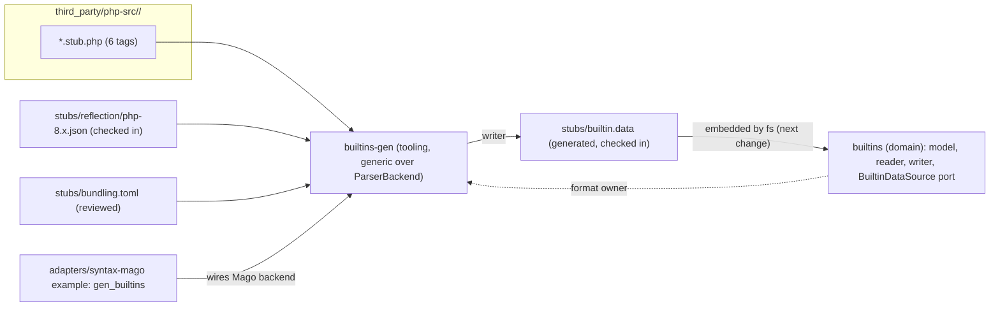

## Context

Findings from research on php-src tags 8.0.30, 8.1.34, 8.2.34, 8.3.35, 8.4.26 and 8.5.11 (counts are regex approximations; to be replaced by parser counts in the first task group):
- Measured with the project's parser (Mago adapter), counting declarations in the syntax tree. Stub files and declarations per release (functions / methods / class-likes / global constants / class constants / properties / enum cases): 8.0.30: 108 files, 2,400 / 1,746 / 222 / 0 / 0 / 0 / 0; 8.1.34: 116, 2,434 / 1,832 / 270 / 0 / 0 / 277 / 6; 8.2.34: 120, 2,464 / 1,896 / 291 / 3,032 / 1,337 / 298 / 9; 8.3.35: 124, 2,487 / 1,929 / 313 / 3,313 / 1,352 / 311 / 13; 8.4.26: 129, 2,317 / 2,164 / 359 / 3,286 / 1,438 / 419 / 34; 8.5.11: 131, 2,341 / 2,252 / 376 / 3,329 / 1,468 / 434 / 65. These counts include the excluded test-only extensions. About 1 MB of text for 8.5.
- 8.0 stubs use only `@generate-function-entries`; the class-entries generator arrived in 8.1. 8.0 and 8.1 stubs contain no constants; from 8.2 constants are stubbed as `const X = UNKNOWN;` with `@cvalue` and `@var` (values are never in the stubs). About 178 constants stay registered in C code in later versions.
- `#if/#else/#ifdef` lines are PHP comments: a plain parse sees guarded symbols unconditionally and sometimes both branches (19 files fail `php -l` with "cannot redeclare"). 44 files in 8.5 contain guards.
- No version availability is stored in the stubs (`@since` appears only in `ext/zend_test`).
- Deprecations appear both as `@deprecated` and `#[\Deprecated]`; 8.5 adds attributes on global constants and `#[\NoDiscard]`.
- Licences: every 8.0 to 8.5 tag carries PHP License 3.01 at the root and Zend Engine License 2.00 under `Zend/`; only `master` and `PHP-8.6` carry BSD-3-Clause. Other PHP tools (phpstorm-stubs, Phan, PHPStan, Psalm, Mago prelude) redistribute signature data without PHP or Zend notices, but none was shown to derive directly from php-src stubs, and no PHP Group statement on reuse was found.
- Decisions taken with the project owner: php-src stubs are the primary source with Reflection as oracle and gap filler (hybrid); the six stub trees are vendored; a NOTICE is shipped; the output is a compact data file (not PHP declaration files); work is split into this change and `symbols-and-types`.
- Repo facts: layering allows tooling crates to depend only on domain crates; the Mago adapter already uses a dev-dependency example (`spike.rs`) pattern; `architecture.toml` bans I/O and format crates in domain crates.

## Goals / Non-Goals

**Goals:** complete, mechanically derived, deterministic built-in data for PHP 8.0 to 8.5 with exact signatures and version masks; independent verification against real interpreters; honest licence handling; cheap regeneration for new PHP releases.

**Non-Goals:** consuming the data in the symbol table (next change), taint knowledge, PECL extensions, evaluating default expressions, running PHP in required CI.

## Decisions

### D1. Crates and flow

- `bleedthrough-builtins` (domain, no dependencies) owns the record model, the canonical text format (reader and writer) and the port. The writer lives with the reader so the format has one definition.
- `bleedthrough-builtins-gen` (tooling) may depend only on domain crates (`syntax`, `builtins`) plus `serde_json` for fixtures; it is generic over `ParserBackend`. The concrete binary is an example in the Mago adapter (dev-dependency on the generator, as with the spike), invoked by `cargo xtask gen-builtins`. Alternative rejected: a delivery-layer crate wiring the adapter, which would add a crate to the workspace layers for a developer-only tool.
- The data file is embedded by `bleedthrough-fs` in `symbols-and-types`; this change delivers only the data, the model and the port.

### D2. Record model and version masks

Six versions fit a `u8` mask today; the type is a `u16` bitset so 8.6 and 8.7 fit without a format change (the format stores the mask as a compact range list such as `8.0,8.2-8.5`). A symbol is keyed by (kind, lower-cased FQN); constants keep case. When signatures differ between versions, the merge produces one record per distinct normalised signature with non-overlapping masks, so version lookup is exact and tentative-versus-declared return types, added parameters and widened types are represented without special cases. Extension bundling is a separate small table (`extension, version -> bundled|unbundled`) sourced from `stubs/bundling.toml`, which cites php.net release notes and the PECL move announcements; "unbundled" is reported differently from "removed".

### D3. Text format

Line oriented, UTF-8, LF, one record per line, tab-separated fixed-order fields, a header line `bleedthrough-builtins 1`, records sorted by (kind, name, mask). Parameters inside a signature use a compact delimited list with escapes for tab, newline and the delimiters. Types are PHP type text, defaults are expression text. The format has a strict reader (rejects unknown versions and kinds, duplicates, overlaps, wrong field counts, with line numbers) and a canonical writer, and a round-trip test guarantees read-then-write is byte-identical. Prose is structurally impossible because fields are typed (names, flags, type text, expression text); a validator rejects type or default fields containing whitespace-separated words beyond the PHP type and expression grammars. Estimated size: a few hundred KB, to be measured in the first task group.

### D4. Reading stubs: guards, annotations, known gaps

The generator parses each stub with the project's pipeline (Mago adapter through the port). Because guard lines are comments, the generator scans lines for `#if*`, `#elif`, `#else`, `#endif`, maintains a guard stack, and associates each declaration with the guard stack active at the declaration's start line (spans give byte offsets; the line index converts). Declarations of the same symbol in different branches merge into one record with guard alternatives. Annotations are read from the declaration's raw docblock (via `docblock_before`) and attributes in the tree; the known set is a table in the generator, and any other `@tag` fails the run unless allow-listed. Prose is discarded at the source: only recognised tags are tokenised.

The first task group verifies that Mago 1.57 parses every stub of every tag with no error or unsupported node (research reported failures only under `php -l`, which is a semantic compiler pass, not a parser; whether the grammar for attributes on global constants and `exit`-named constructs parses was not verified). Any construct Mago cannot parse becomes an entry in `known-gaps` with a reason, or is resolved by a Mago pin upgrade through the existing upgrade procedure. The gate is whether the generator can run to completion with an explicit, reviewed gap list.

Result of that verification (task group 1): Mago 1.57 (the latest release) parses all stubs of all six tags. Before a fix, 56 constants carrying `#[\Deprecated]` (8.3 to 8.5) and 3 in `zend_test` produced an error node for their attribute, so the attribute and with it the deprecation data were lost; the constants themselves were still converted. The cause is Mago's span for a constant statement and a class constant, which starts at `const` or the modifier and excludes the attributes, so the adapter saw the attribute as unconverted source. The adapter now includes attribute lists in those spans and the global `Const` statement carries `attributes`; no Mago upgrade and no known gap is needed, so the known-gap file for stubs is empty.

### D5. Coverage report and no-silent-drop

For each stub file and version the generator counts declarations by kind from the tree (independent of the extraction code path, using the syntax visitor) and counts records produced; the two must match after exclusions. The report is written beside the data (`stubs/coverage.txt`, deterministic) and checked in; its diff is part of review when sources change.

### D6. Reflection: fixtures, filling, cross-check

`stubs/reflection/dump.php` is a small, reviewed script using `ReflectionFunction`, `ReflectionClass`, `ReflectionExtension` and `get_defined_constants(true)`; it prints canonical JSON with sorted keys and no docs. Images: `php:8.0-cli` to `php:8.5-cli` by digest, recorded with loaded extensions. Because images ship a subset of extensions, the fixture can only confirm and fill what is loaded; symbols outside it are reported "not covered by oracle" rather than as agreement.

Roles: (1) fill 8.0/8.1 constants and properties and all constant values (marked `reflection`); (2) cross-check function/class presence and signatures for 8.0 to 8.5. The comparison normalises type spelling (`?T` versus `T|null`, ordering of union members, `self` forms) before comparing, and allow-lists known differences in `stubs/oracle-allow.toml` with reasons; stale allowances fail. The script runs only manually (`cargo xtask refresh-reflection`, which requires Docker and prints what it will run and asks for explicit invocation); required CI never runs PHP or pulls images. Downloaded images are untrusted executables: the digest pin and review of the script are the controls, and the output contains only data.

### D7. Vendoring and licensing

`third_party/php-src/<tag>/` mirrors upstream paths for `*.stub.php` only, plus the root `LICENSE` and `Zend/LICENSE` for that tag. `stubs/MANIFEST.toml` records tag, commit SHA and a SHA-256 per file. A one-off helper `cargo xtask vendor-php-src --tag ...` (network, explicit invocation) fetches and writes files and updates the manifest; the verification path (`check-builtins`) needs no network. `NOTICE` holds both licence texts and states that the built-in data is derived from the PHP source files; release and Docker builds include it and a check enforces presence. Release packaging does not exist yet, so the repository carries a placeholder `Dockerfile` and `release/archive.toml` that name `NOTICE`; the presence check guards them and future packaging must follow them (they are not built by any pipeline yet). A `docs/licensing-builtins.md` records research findings (including what other projects do) and the unconfirmed status; a release-checklist item blocks the first public release until the owner records a decision. This is explicitly not legal advice; nothing here concludes that 3.01 binds derived data, the NOTICE is the conservative choice.

### D8. xtask commands and gates

- `gen-builtins`: regenerate `stubs/builtin.data` and `stubs/coverage.txt` (offline).
- `check-builtins`: regenerate to a temporary location and diff; verify manifest hashes and unlisted files; NOTICE presence; format validity. Part of `check-all`.
- `refresh-reflection` and `vendor-php-src`: manual, networked, never run in required CI.

Vendored and generated directories are excluded from the formatting and lint steps by configuration; the layering and domain-purity checks keep applying to the crates.

## Risks / Trade-offs

- [Mago cannot parse some stub constructs] -> first task group measures it; known-gaps list or Mago upgrade; fail loudly rather than skip.
- [Guard handling is line based and could mis-associate a declaration] -> guard stack tests on fixtures taken from real stubs; coverage report; Reflection cross-check catches missing symbols on common builds.
- [Licence position unresolved] -> NOTICE shipped, facts only, release gate on owner decision, documented research.
- [Reflection images lack extensions] -> reported as not covered; stubs remain primary.
- [Repository grows by about 5 MB of vendored stubs] -> accepted; content-pinned offline regeneration; stub-only files.
- [Future PHP releases add annotations] -> unknown-annotation failure makes drift visible.
- [Type spelling differences between stubs and Reflection] -> normaliser plus reviewed allowances.
- [Scope is large] -> staged task groups; each group ships a verified increment (model, parse gate, extraction, merge, oracle, gates).

## Migration Plan

1. Verify parsing of stubs; 2. model and format; 3. vendoring and manifest; 4. extraction per version; 5. merge, bundling, coverage; 6. Reflection fixtures, fill and cross-check; 7. NOTICE, gates, docs. No data migration; `symbols-and-types` is updated to consume the port instead of writing stubs.

## Open Questions

- Exact type-spelling normalisation rules (settled while building the cross-check).
- Whether `--no-default-features`-style build variants (Windows-only functions) should be represented beyond guard text; v1 records guard text only.
- Licence decision by the owner or counsel before the first public release (a gate, not a design blocker).
