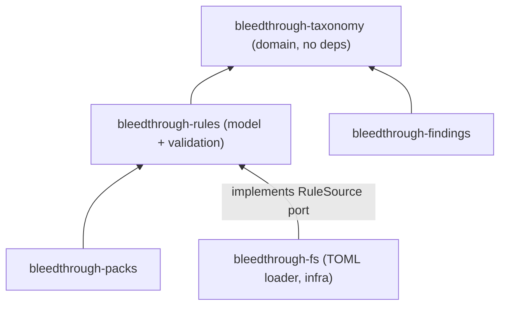
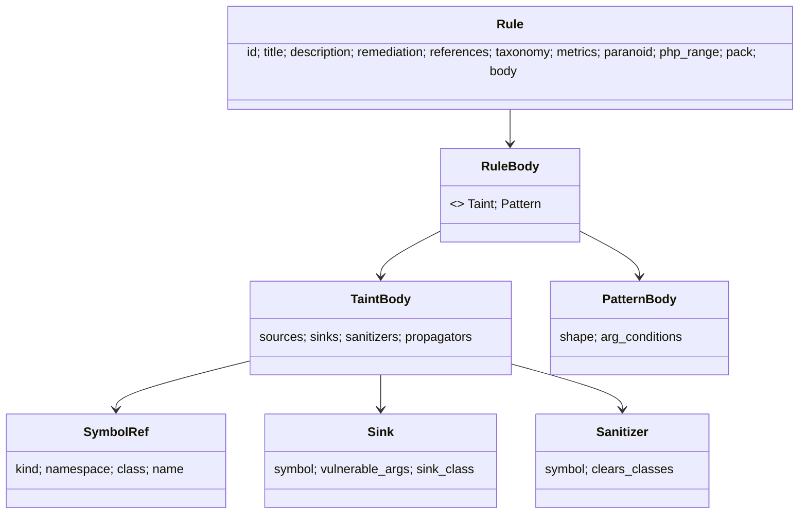

## Context

Observed in the repository:
- `bleedthrough-findings` currently owns `Cwe`, `OwaspRef`, `Taxonomy`, `SeverityLevel` and `Severity` (score in integer tenths 0..=100, opaque vector string). `Taxonomy::new` already rejects empty CWE or OWASP lists.
- `bleedthrough-rules` is an empty domain skeleton whose `architecture.toml` entry allows no workspace dependency; `bleedthrough-packs` may depend only on rules; `bleedthrough-fs` may depend on app, rules and packs.
- Earlier decisions: rules are TOML; every rule must be tagged with CWE and OWASP (2021); severity is derived from CVSS-like scoring; XSS (CWE-79) is deferred past v1; open redirect (CWE-601) is in v1; packs are per library; the glossary check requires `Term:` doc lines on public domain types.

## Goals / Non-Goals

**Goals:** one shared, validated vocabulary; a deterministic severity formula; a strict rule schema that the catalog, packs and engine can build on; precise load errors; a rule-set hash for cache keys and reports.

**Non-Goals:** the rule catalog itself, pack activation, engine evaluation semantics, a general pattern DSL, CLI wiring, WASM packs.

## Decisions

### D1. A `bleedthrough-taxonomy` domain crate

`Cwe`, `OwaspRef`, `Taxonomy`, `SeverityLevel`, `Severity` and the new registry and scoring move to the taxonomy crate. `findings` keeps its own finding types and uses the taxonomy types in its public interface; it does not re-export them, so there is one import path. Alternatives rejected: letting rules depend on findings (inverts the natural direction), and raw ids in rules (invalid tags would surface late). API snapshots for findings change; the move is internal because nothing is released.

### D2. Registry as compiled-in static data

The registry is a Rust table (CWE number, name, catalog version checked, OWASP 2021 category ids) with lookup functions, not a loaded file, so the domain stays free of I/O and the table is covered by API/unit tests. Names are taken from the MITRE CWE catalog and category names from the OWASP Top 10 2021 publication while authoring (never from memory); the source and catalog version are recorded in a doc comment and in `docs/taxonomy.md`. The mapping check (a category must be in the mapping of at least one of the rule's weaknesses, or be added with a stated reason) catches typos such as tagging SQL injection as A02. A rule may carry `owasp_extra` entries each with a `reason` string for deliberate cross-mappings.

### D3. Severity: CVSS 3.1 base metrics, exact arithmetic

Rules declare AV, AC, PR, UI, S, C, I, A. The score uses the CVSS 3.1 base equations; the specification's `Roundup` is implemented on integers (metric weights as thousandths, as the specification's reference implementation does to avoid floating-point error), so results are identical everywhere. The score is stored as integer tenths, which matches the existing `Severity` representation. Level thresholds follow the CVSS qualitative scale. The vector is `CVSS:3.1/...`. It is a rule author's base estimate; docs and the report field description say so. A `severity_scheme` version (`1`) is part of the report options. The existing `Severity::with_score_tenths` stays for producers without metrics.

Alternative rejected: engine adjustments of exploitability per flow. It couples severity to analysis internals and would complicate gating and baselines; confidence is the per-flow signal.

### D4. Rule model and validation in `bleedthrough-rules`

Types are constructed through validating builders; fields are private so an invalid rule cannot exist. `SymbolRef` is data (kind, namespace, class, name; `Class::method`, `Class::__construct`, `\ns\func`, superglobal), without resolution; matching semantics (inheritance, aliasing) are the engine's concern, but the schema records an `include_subclasses` flag for methods because it changes meaning and must be explicit. Sink classes are a closed enum. Pattern shapes are a closed enum (call, use, non-literal include); regular expressions in argument conditions are restricted to the linear-time subset by validating through a small allow-list of constructs at load time, with the engine free to choose its matcher.

### D5. Loader port and TOML in infrastructure

The rules crate owns `RuleSource` (yields rule definitions or a list of located errors). `bleedthrough-fs` implements it for TOML using `toml` (with spans, for line numbers) and `serde`, with `deny_unknown_fields` semantics, and collects all errors per file. Parsing is separated from validation: TOML maps to plain definition structs, which the rules crate validates and turns into `Rule`. File layout: `rules/<area>/*.toml`, one or several rules per file; `schema = 1` at the top of each file. Alternative considered: a dedicated adapter crate for TOML; rejected for now since `fs` already is the file-reading infrastructure, and pack loading will reuse it.

### D6. Rule-set hash and ordering

The rule set is a sorted map by identifier. The hash is SHA-256 over a canonical serialization of the validated model (not the file bytes), so comments and key order do not matter. Hashing lives in the infrastructure loader (the domain stays free of hashing dependencies other than the findings crate's existing `sha2`); the rules crate exposes a canonical form for it. The hash is reported in the run options and enters cache keys.

### D7. Identifier scheme

`BT` plus four digits, immutable once released; area and name live in metadata fields (`area`, `title`) rather than the id, so renames do not break baselines (which key on fingerprints that contain the rule id). Retired identifiers are listed in `rules/RETIRED.md` and checked so they are never reissued.

### D8. Documentation and checks

`docs/rule-schema.md` is the reference with a worked example for a taint rule and a pattern rule; `docs/taxonomy.md` records registry sources and the procedure for adding a weakness. A schema example embedded in the doc is parsed by a test so the doc cannot rot.

## Risks / Trade-offs

- [CVSS authority: scores are estimates, not official] -> vector and report text state this; the scheme is versioned; a later change can add overrides if needed.
- [A curated registry can lag the MITRE catalog] -> adding an entry is a one-edit, reviewed change; names carry the checked catalog version.
- [Moving types churns API snapshots] -> done in one task with snapshot regeneration reviewed; nothing is released yet.
- [Rule schema too narrow for later needs] -> versioned schema, additive changes allowed, closed vocabularies extensible by editing the crate.
- [Linear-time regex subset is hard to enforce] -> start with a very small allowed syntax (literals, classes, anchors, bounded repetition) and reject the rest.
- [Closed sink-class vocabulary may need growth when the catalog is written] -> expected; `v1-rule-catalog` may extend it in its own change.

## Migration Plan

1. Create the taxonomy crate and move the existing types with their tests.
2. Point findings at it; regenerate snapshots.
3. Add registry and scoring; then the rule model; then the loader; then docs and checks.
No data migration; no released artifacts.

## Deferred to scan-pipeline

Recording `severity_scheme` and the rule-set hash in the run options, the cache keys, and the "estimate" wording in the output-format docs are wired by `scan-pipeline`, which owns the report options and the CLI. This change provides the constant, the hash and the doc text in `docs/rule-schema.md`.

## Open Questions

- The exact initial CWE list is fixed by `v1-rule-catalog`; this change ships the registry with the entries needed by the schema tests and by the scope in the spec, extended by the catalog.
- Whether `rules check` validates pack-supplied rules too is decided in `pack-system`.
